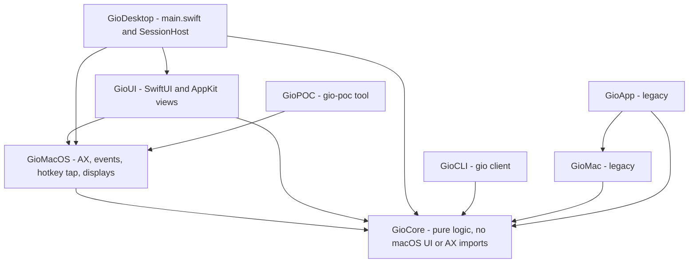
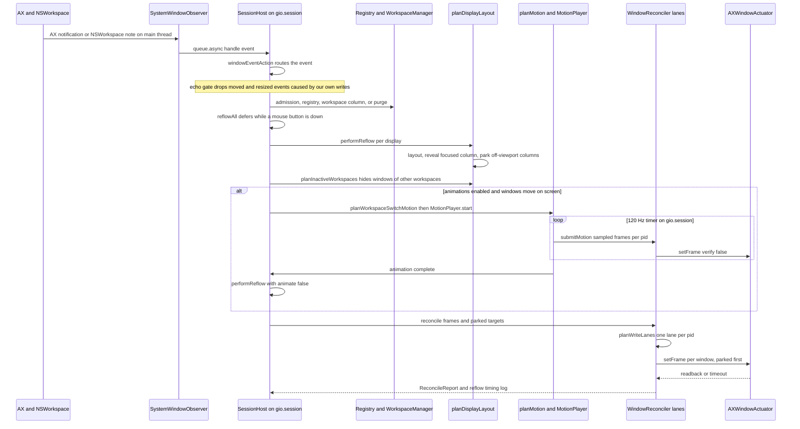
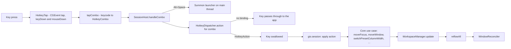
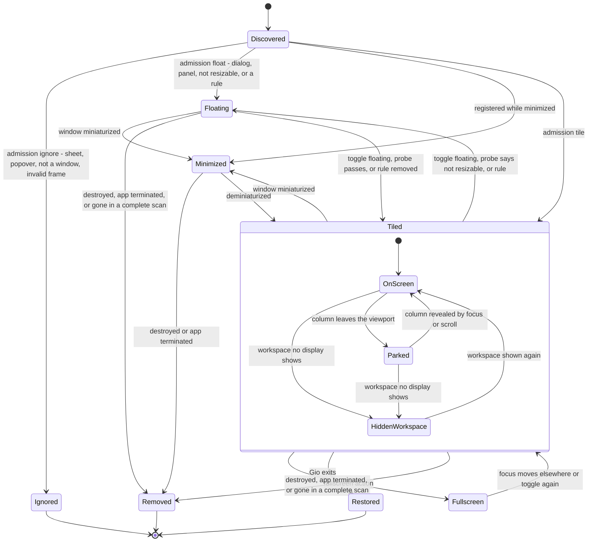
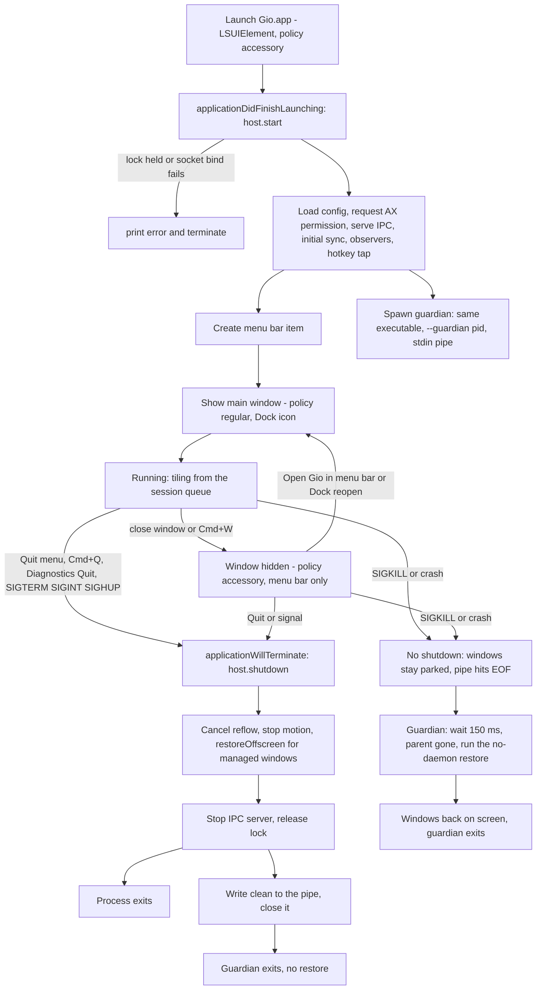

# Architecture

This document explains how Gio is put together, which rules keep it correct, and how a macOS event becomes a window movement. Every claim was checked against the code at the time of writing; where behavior is legacy, unfinished or unverified live, the text says so.

Contents: [Modules](#modules-and-dependency-rules) · [Invariants](#core-invariants) · [State model](#state-model) · [Event pipeline](#event-pipeline) · [Layout details](#layout-details) · [Hotkeys](#hotkey-flow) · [Window lifecycle](#window-lifecycle) · [App lifecycle](#app-lifecycle) · [Coordinate spaces](#coordinate-spaces) · [Concurrency](#concurrency-model)

## Modules and dependency rules

| Target | Kind | Depends on | Role |
| --- | --- | --- | --- |
| `GioCore` | library | none | All decisions: window registry, workspaces, layout, viewport, focus, move/resize, parking, motion planning, reconciler, hotkeys, config, rules, IPC, logging, recovery. Imports only `Foundation`, `CoreGraphics`, `Dispatch`, `Darwin`. |
| `GioMacOS` | library | `GioCore` | macOS adapters: Accessibility discovery and events, `AXWindowActuator`, the `CGEvent` hotkey tap, display snapshots, restore/tile assemblies. |
| `GioUI` | library | `GioCore`, `GioMacOS` | SwiftUI/AppKit: main window, menu bar, launcher, settings views and their view models. |
| `GioDesktop` | executable | `GioCore`, `GioMacOS`, `GioUI` | `main.swift` (app delegate, lifecycle) and `SessionHost.swift` (the live session). Built by the Xcode `Gio` target as `Gio.app`. |
| `GioCLI` | executable | `GioCore` | The `gio` client. The SwiftPM executable is named **`GioCLI`**; its usage text prints `gio`. |
| `GioPOC` | executable | `GioMacOS` | `gio-poc`: Accessibility proof of concept, one-shot tile, and `restore` recovery. |
| `GioMac`, `GioApp` | library, executable | `GioCore` (+ `GioMac`) | **Legacy** prototype from before the rewrite. Not part of the running app. |



**Dependency rules**

1. Arrows point toward `GioCore`. `GioCore` never imports `AppKit`, `ApplicationServices`, SwiftUI or any macOS UI/AX framework. The compiler enforces this because the target declares no dependencies; keep it that way.
2. Decisions live in `GioCore` as pure functions or small value types with XCTest coverage. Adapters (`GioMacOS`, `GioUI`, `GioDesktop`) translate between the OS and Core types and contain as little logic as possible.
3. `GioCore` reaches the OS only through protocols it owns (for example `WindowActuator`, `MotionFrameSink`) that adapters implement.
4. `GioUI` may import `GioMacOS` (for the Accessibility permission request) but must not touch session state directly; it receives `SessionSnapshot` values and calls `DesktopActions` closures.
5. New UI code goes in `GioUI`, not `GioDesktop` (see [CONTRIBUTING](CONTRIBUTING.md#add-a-desktop-app-section)).

## Core invariants

These are hard rules. Break one and the design stops working.

| # | Invariant | Why it exists |
| --- | --- | --- |
| 1 | **State is the source of truth.** The registry, `WorkspaceManager` and `DisplayManager` hold the logical world. Windows on screen are a projection of it. | Prevents reading positions back from apps and fighting them. |
| 2 | **`LayoutEngine` knows no macOS.** `ScrollableLayoutEngine.calculate(workspace:viewport:)` maps a `Workspace` and a viewport rect to absolute frames. No AX types, no clocks. | Makes layout deterministic and testable. |
| 3 | **Only `WindowReconciler` writes window frames.** Flow is always State, then Layout, then Reconciler, then macOS; never hotkey to AX. The reconciler diffs desired against actual and writes only deltas. | One place to enforce tolerances, lanes, timeouts and parking. |
| 4 | **Logic changes go through Core use cases.** Hotkeys and IPC verbs map to actions; actions are pure functions on `Workspace` or the registry. | Keeps behavior testable without a display. |
| 5 | **Gio never manages or actuates its own process.** | See below. |
| 6 | **Logs never contain window titles.** Log lines carry numeric IDs (`pid:elementID`), counts, timings and app names. | Privacy. Titles are kept in memory only and shown in the app, not logged. |
| 7 | **An invalid config never breaks the window manager.** Errors fall back to defaults; unknown keys and tables only warn. | The WM must keep running. |
| 8 | **Absence is not death.** A window or app is removed only on proof: a destroyed event, a terminated pid, or a vanished window in a *complete* scan of that pid. | Enumeration gaps must never wipe state. |
| 9 | **Physical writes never mutate logical state.** Animation only changes what the reconciler writes; workspace state already holds the final layout. | Animation can be cancelled or retargeted without corrupting state. |

Invariant 3 has no exceptions. Every write, including the off-screen prepositioning of incoming windows before a workspace-switch animation (`preposition`), animation frames, and restore, goes through `WindowReconciler` (`preposition`, `submitMotion`, `reconcile`, `restoreOffscreen`). Do not add direct writes.

### Why Gio never touches its own windows (commit `bac43c6`)

Once the main window made Gio a regular app, clicking it made Gio the frontmost application. Focus adoption then registered Gio's own window, and the motion lanes wrote its position through Accessibility from a background thread. AX calls on in-process elements execute AppKit code on the calling thread, which crashed inside `NSWMWindowCoordinator`. The fix refuses Gio's own pid in three places:

- `SessionHost.requestFocusAdoption` returns early for `ProcessInfo.processInfo.processIdentifier`.
- `isManageableProcess(pid:ownPID:onlyPID:)` in `GioMacOS` filters discovery (`discoverSystemWindows`, `discoverSystemWindow`).
- `AXWindowActuator.register` ignores handles for the own pid, so no lane can ever write them.

Any new code path that enumerates windows or adopts focus must go through these guards.

## State model

| Type | Meaning |
| --- | --- |
| `WindowID` | `pid` + `elementID`. `elementID` is assigned by the session (no stable public window number exists); identity across rescans is a retained AX handle matched with `CFEqual`. |
| `ManagedWindow` | Registry record: app name, title, last logical frame, `WindowMode` (`tiled`, `floating`, `fullscreen`), optional `FloatReason`, `isMinimized`. |
| `WindowRegistry` | Single owner of window membership (managed vs ignored). |
| `Column` | Ordered vertical stack of `WindowID`s, a `ColumnWidthSpec` (`standard`, `proportion`, `points`), optional saved width (maximize toggle) and per-window height weights. |
| `Workspace` | Horizontal strip of columns, `focusedColumn`, `focusedWindow`, `viewportOffset`. |
| `WorkspaceManager` | Nine workspaces (`1...9`) and the current index. |
| `DisplayManager` / `DisplayState` | Per display: frame, which workspace it shows, viewport. Connecting or disconnecting a display never touches workspaces. |

## Event pipeline

The session runs on one serial queue, `gio.session`, owned by `SessionHost`. Every mutation and every reflow happens there. A macOS event travels like this:



Stage by stage:

1. **Intake (`GioMacOS/Accessibility/WindowEvents.swift`).** `SystemWindowObserver` keeps one `AXObserver` per app (window created, focused window changed, moved, resized, miniaturized, deminiaturized, title changed, element destroyed) plus `NSWorkspace` launch, terminate and activate notifications. Events arrive on the main run loop and are forwarded to `queue.async`.
2. **Routing (`GioCore/Window/WindowEventPolicy.swift`).** `windowEventAction(for:isKnownWindow:)` is a pure table: register, remove, frameChanged, reflow, minimize, restore, updateTitle, adoptFocus, resync, ignore.
3. **Admission and registration (`registerNew`, `classifyWindowAdmission`).** Each new window is classified as `tile`, `float(reason)`, `ignore(reason)` or `suspend(reason)`. Config rules (`evaluateRules`, first match by exact app name wins) can override mode and workspace at arrival. The window gets a fresh column on the target workspace and a per-window observer. Attributes of a brand-new window are often unreadable, so registration retries after 0.1, 0.3 and 0.8 s (`WindowRegistrationRetry`). Observer attachment to a launched app retries after 0.25, 0.5, 1 and 2 s (`ObservationRetry`).
4. **Debounce.** Events that need a rescan call `scheduleReflow`, debounced by 0.3 s (`full: true` re-enumerates; `full: false` only re-lays out). Registration, removal, minimize and restore reflow immediately.
5. **Mouse guard (`ReflowDeferral`).** While a mouse button is down, `reflowAll` polls every 50 ms and coalesces requests, then reflows once after release. Nothing moves under the cursor.
6. **Layout planning (`planDisplayLayout`).** Per display: lay out the strip, compute the minimal scroll that reveals the focused column, lay out again from that offset, then split frames into visible and parked. In real fullscreen the covering window gets the display frame and everything else parks where its column already is. `planInactiveWorkspaces` computes hidden positions for windows of workspaces no display shows.
7. **Motion.** If animation is active, `planWorkspaceSwitchMotion` (which wraps `planMotion`) picks the windows that are on screen at the start or the end and builds `WindowAnimation`s; `MotionPlayer` is driven by a timer at about 120 Hz (8333 microseconds) on the session queue. See [Motion](#motion-and-retargeting).
8. **Reconcile (`WindowReconciler.reconcile`).** Windows are grouped by pid into lanes; each lane runs on its own thread. See [Write lanes](#write-lanes-and-timeouts).
9. **Actuation (`AXWindowActuator`).** Converts Cocoa frames to AX, orders position and size writes, verifies visible writes with a readback, and enforces a per-element messaging timeout.
10. **Echo suppression.** Applied frames are recorded in `WriteEchoGate`; see [Echo gate](#echo-gate).

IPC (`gio` CLI) enters the same queue: `IPCServer` calls `queue.sync { handleIPC }`, and verbs that change state (`focus`, `move`, `workspace`, `reload`) end in `reflowAll`.

## Layout details

### Niri proportion width

A column of proportion `p` takes that share of the strip after padding:

```
width = p * (viewportWidth - 2 * padding + gap) - gap
```

So `1/p` such columns plus their gaps fill the viewport exactly. Example: viewport 1800, padding 8, gap 8, `p = 0.5` gives `0.5 * 1792 - 8 = 888`; two columns take `888 * 2 + 8 + 16 = 1800`. Widths are floored at `minimumColumnWidth` (200). `default-column-width` values up to 1 are proportions, larger values are points (`GioCore/Resize/ColumnWidth.swift`, `GioCore/Layout/LayoutEngine.swift`). The same function is used by the engine and by the width actions so what you see is what actions compare against.

### Reveal and scroll

The focused column is always revealed by the smallest possible scroll (`revealOffset` with `Viewport.ensureVisible`). A column wider than the viewport pins to its start. Offsets are clamped to `[0, contentWidth - viewportWidth]`. Center-column (`Alt+C`) sets the offset so the focused column is centered, clamped at the strip edges.

### Parking

macOS refuses to place a window fully off-screen, so a window that is not visible keeps a sliver inside the display (`parkingSliver = 1` point). All parking is computed against the **full display frame**, not the usable area, so a Dock inset never leaves a parked window visible.

| Situation | Where the window goes |
| --- | --- |
| Column left of the viewport | x = `display.minX - width + 1`, keeps its y and size (left edge). |
| Column right of the viewport | x = `display.maxX - 1` (right edge). |
| The preferred edge would overlap another display | The other edge is tried. |
| Both edges touch another display | Bottom-right corner: x = `display.maxX - 1`, y = `display.minY - height + 1`. |
| Window of an inactive **workspace** | Always below the display: bottom-right corner, bottom-left if a neighbour overlaps it, size kept. Floating windows remember their frame (`HiddenWindowBook`) and return to it when their workspace is shown. |

Reconciler behavior for parked targets: written before visible windows in the same lane, never verified by readback, never focused. A landing counts as parked (`already correct`) if the size is unchanged and no more than `parkedStripLimit` (40 pt) of the window remains inside the display on the intended side, because macOS may clamp the requested position (`isParked`). A `parked clamped` debug line records this.

### Write lanes and timeouts

`planWriteLanes` builds one lane per pid. Inside a lane the order is fixed: parked targets first, then visible frames, each sorted by `WindowID`. Lanes run concurrently (`LaneConcurrency.concurrent(stallTimeout: 0.25)`).

- A lane that makes no progress for **0.25 s** is abandoned: its unfinished windows are reported as `failed` with `timeout` and the reflow returns without waiting.
- The abandoned pid stays marked busy until its thread comes back. Further writes to that pid are skipped with `timeout (previous write to this app still pending)`, so a hung app is never written by two overlapping lanes.
- `AXWindowActuator.messagingTimeoutSeconds = 0.25` is applied to each AX element (the system default is about 6 s). The same timeout affects discovery reads on slow apps.
- Per window the reconciler reads the actual frame, skips the write if it is within `tolerance` (1 pt) of the target or already parked, and otherwise calls `setFrame(_:from:for:verify:)` with the frame it already read (no second read).
- Write order in the actuator: position first when the target grows in either dimension, size first when shrinking, to avoid macOS clamping a large frame written from a small position.
- Every failed window is logged by `WindowReconciler` as `reconcile failure id= app= kind= requested= actual=` (FI-01). `ReconcileReport.failures` carries the same data structured (`ReconcileFailure`). Adapter errors report their kind through `FrameFailureReporting`, so `GioCore` stays free of adapter types. `FailureLogGate` warns once per (window, kind) and logs repeats at debug.
- Focus, when requested, is applied last, after every lane. `SessionHost.performReflow` passes a focus target only when a keyboard or IPC action left a `FocusIntent` (focus, move, workspace, consume/expel, fullscreen). The target is focused and raised after its frame is written; during an animation it is held until the final exact pass. Passive reflows (AX events, click adoption, reload, rescans) pass `nil` and never steal focus. `FocusIntent` also ignores trailing activation events that contradict a fresh intent, and a mouse click cancels it.

### Motion and retargeting

- `planMotion` animates a window only if its start frame **or** its target frame is on screen (more than two parking slivers inside the viewport). Typically 2 to 4 windows; parked-to-parked moves jump in the final pass.
- Start frames come from `physicalFrames`, the last frame Gio applied or sampled. A window with no known frame is read once (`learnPhysicalFrames`) so new windows can slide in.
- `MotionPlayer.start` on a run in flight **retargets**: new animations replace the old ones starting from the sampled frames and the clock restarts, while the run's counters continue, so nothing snaps back.
- Each timer tick samples every animation by elapsed time (late ticks stay honest) and hands the changed frames to `submitMotion`, one submission per pid. `submitMotion` never blocks or queues: if that app's previous frame is still being written the frame is dropped for that app (`dropped` counter).
- When the last animation completes, `performReflow(animate: false)` runs the exact final reconcile with verification.
- If a mouse button goes down mid-flight the animation is abandoned, `skipAnimationOnce` is set and the deferred reflow finishes instantly after release.
- Easing: `easeOut` for scroll and focus moves, `easeInOut` for workspace slides. Default duration 200 ms (`[animations]`).
- Workspace switches move vertically through the bottom edge (macOS cannot place windows above the menu bar): outgoing windows drop below the display, incoming hidden windows rise from directly below their target after an invisible pre-position write.

### Echo gate

Gio's own writes raise moved and resized events. `WriteEchoGate` records every applied frame with the system uptime. An event for that window is ignored if it arrives within **0.35 s** of the write (the AX read is skipped entirely) or if the window's observed frame is within **2 pt** of the last applied frame. Without this, write, event, reflow, write would loop.

### Focus settle

Clicking a window makes the activation event and the focused-window event outrun the app's own `AXFocusedWindow`. `FocusSettle` (pure state machine in `GioCore/Focus/FocusSettle.swift`) handles it:

1. Keyboard-driven focus events (no click in the last 0.3 s) are adopted immediately.
2. Mouse-driven ones are coalesced (last event wins), wait for the button to be released plus an 80 ms settle delay (polling every 20 ms), then the focused window is read.
3. The window must contain the click point (2 pt slack). On mismatch it is re-read once after 100 ms; a second mismatch drops the adoption and logs `focus dropped`.
4. Clicks outside every display's usable area (menu bar, Dock) are not window clicks. Focus events from a non-frontmost app and from Gio itself are ignored.
5. After adoption a reflow happens only if the viewport has to scroll to show the focused column (`pendingScroll`).

Frontmost-app rule: a full rescan adopts the focused window of the **frontmost** app only; adopting "the last app that reported a focused window" scrolled the strip to an arbitrary column (fix `4a6351b`).

## Hotkey flow



Notes:

- The tap is a `cgSessionEventTap` inserted at the head, running on the main run loop. It observes mouse-downs (never swallowed) and swallows only key-downs that exactly match a bound combo, so ordinary typing is unaffected.
- Key names live in one shared vocabulary, `supportedKeyNames` (`GioCore/Hotkeys/KeyNames.swift`): A-Z, 0-9, F1-F12, arrows, Tab/Return/Escape/Space/Delete, Home/End/PageUp/PageDown and punctuation. `parseHotkey` accepts only these (plus aliases); `tapKeyCodes` in `GioMacOS/Hotkeys/HotkeyTap.swift` maps each name to its ANSI keycode, and a test keeps both identical. A config binding on any other key is a validation error.
- `Alt+Space` is intercepted in `handleCombo` before the dispatcher and is not configurable.
- The dispatcher is rebuilt from `config.makeDispatcher()` at start and on every reload (`refreshDispatcher`). Config bindings are additive: they bind or override combos on top of the defaults, and there is no unbind syntax.
- If the tap cannot start (no Accessibility permission), Gio keeps running without global hotkeys and retries on the next resync.

## Window lifecycle



Details that the diagram compresses:

- **Admission** (`classifyWindowAdmission`): role must be `AXWindow`; `AXSheet` and `AXPopover` are ignored; `AXDialog`/`AXSystemDialog` float as `dialog`; `AXFloatingWindow`/`AXSystemFloatingWindow` float as `floatingSubrole`; invalid frames are ignored; native fullscreen and minimized windows are `suspend` candidates; an unknown or empty subrole tiles if position and size are settable (Electron, Java and Qt windows), otherwise floats as `notResizable`.
- **Floating is managed, not omitted.** Floating windows stay registered with a reason (`dialog`, `floatingSubrole`, `notResizable`, `rule`, `manual`), keep their own frame, and are visible in the Overview. Tileability is probed once per window and cached (`TileabilityCache`), invalidated on resize events.
- **Minimized** windows keep their column (position memory) but sit out of the layout; focus is handed to the nearest visible window (same column, then right, then left).
- **Fullscreen** here is Gio's own layout mode, not a native macOS fullscreen Space: the window gets the display width and reaches the bottom edge but stops under the menu bar, all tiled windows park where their columns are, and leaving restores the previous mode and frame.
- **Restored on exit**: `WindowReconciler.restoreOffscreen` (via `planRestore`) writes only windows that are not fully inside a display, cascading from the top-left of the visible frame in 32 pt steps (8 slots), keeping size (shrunk only if larger than the visible frame).
- **Removal**: `AXUIElementDestroyed` removes exactly that window; a terminate notification reaps the pid; a complete scan of a pid that no longer lists a registered window purges it. Partial scans never remove anything.

## App lifecycle



- `main.swift` sets the activation policy to `.accessory` before `run()`; `Info.plist` also sets `LSUIElement`. `desiredActivationPolicy(windowVisible:)` (in `GioUI/MainWindow.swift`) flips it to `.regular` while the main window is visible and back to `.accessory` when it closes.
- The delegate ignores SIGTERM, SIGINT and SIGHUP at the default handler level and routes them through `host.shutdown()` then `terminate`. `shutdown()` is idempotent and synchronous, so the terminate hook can call it again safely.
- **Limitation:** SIGKILL (for example Xcode's Stop), a crash, or a power loss cannot run any handler. The guardian (above) restores them within about a second; if it was not running, parked windows stay at the display edge. Recover with `gio-poc restore` (or the `gio-poc-restore` Xcode scheme) or start Gio again: the initial sync restores leftover off-screen windows that will not be tiled, and the first reflow re-places tiled ones.
- **Guardian (HD-07).** After IPC is serving, `SessionHost.start` calls `spawnGuardian()`, which re-executes the same executable (`Bundle.main.executableURL`) with `--guardian <pid>` and a `Pipe` as the child's stdin. `main.swift` detects the flag before any `NSApplication` setup and calls `runGuardianProcess`: no Dock icon, no menu bar item, no window, no single-instance lock, no IPC. It closes inherited descriptors (so the lock and socket cannot outlive Gio through it). The protocol lives in `GioCore/Commands/Guardian.swift`: `shutdown()` writes `clean\n` and closes the pipe after the restore, so the guardian exits quietly. End-of-stream without `clean` (garbage counts as silence) means Gio died abruptly: after 150 ms the guardian confirms the parent pid is gone (`kill(pid, 0)`), and runs the same restore as `gio-poc restore` (`runRestoreOffscreen`; discovery skips its own pid). If Accessibility is missing it logs and exits. Log lines are `guardian started parent=N`, `guardian clean exit`, `guardian restore applied=N ...`. If the spawn fails Gio logs a warning and runs without it. Assumption to validate live: the child shares the parent's bundle and code signature, so the Accessibility (TCC) grant applies to it; TCC attributes a process to the signed code of its executable, not to who launched it.
- Only one instance runs: `SingleInstanceLock` (`flock` on `~/.config/gio/gio.lock`).

## Coordinate spaces

Gio uses three coordinate conventions and converts at the edges.

| Space | Origin and axes | Where used |
| --- | --- | --- |
| **Cocoa** (`NSScreen`) | Bottom-left of the primary display, y up | Everything in `GioCore`: layout, planners, parking, reconciler, registry frames, restore. |
| **AX** (Accessibility, CG) | Top-left, y down | Only at the adapter boundary: `AXWindowActuator` reads and writes, and the places where `SessionHost` ingests discovered AX frames (`enumerateAndPlace`, `registerNew`). |
| **Content vs screen** (inside the viewport) | Content x is measured from the start of the column strip; screen x is `viewport.minX + contentX - offset` | Layout frames are screen rects, while `viewportOffset` and `Viewport` work in content space. |

- `AXVerticalFlip` converts with `y' = displayHeight - y - height`. It needs the **full** display height, not the visible frame. `SessionHost` uses `NSScreen.main.frame.height` for all displays; the live behavior with several displays of different heights is a recorded gap (single-height flip) and has not been validated live.
- Mixing Cocoa and AX coordinates was the original live failure: windows were placed into the menu bar and macOS clamped `y = 8` to `y = 39` (fix `614ec32`). If a live frame is off by the menu bar height, suspect a missing or double flip.
- **Reveal in content space (fix `592c89d`).** `revealOffset` used to compare screen-space frames with a content-space offset, which produced wrong scrolls (`1824->0`, `1816->916`, `0->16` in the live logs). It now converts with `toContent = layout.viewportOffset - viewport.minX` before calling `ensureVisible`. Any new code that compares a layout frame with `viewportOffset` must convert first.
- Fraction widths ignored padding and gap, so two `0.5` columns overflowed by 16 pt; the fix is `proportionalColumnWidth` (see [Niri proportion width](#niri-proportion-width)).
- Mouse locations from the tap (`NSEvent.mouseLocation`) are Cocoa global coordinates, the same space as window frames, so click-point validation needs no flip.

## Concurrency model

- `SessionHost` is `@unchecked Sendable`; **all session state mutates on the `gio.session` serial queue**. Callers hop on (`async` from UI and tap, `sync` from the IPC thread) and never touch state directly. **Do not nest `queue.sync`**: it deadlocks.
- The hotkey dispatcher table has its own lock because the tap reads it on the main thread.
- The click record (`tappedClick`) has its own lock (tap writes on main, session reads).
- `AXWindowActuator` guards handles and the flip with a lock because reflow lanes read them from several threads and an abandoned lane can outlive its reflow.
- AX observers and hotkey tap sources always run on the **main** run loop. Rebuilt observers once landed on the session queue's run loop, which never runs (fixed in `e9c8066`).
- The UI reads state through `SessionSnapshot` values produced on the session queue; `DesktopModel` publishes them on the main actor.

## Where things live

| Concern | Files |
| --- | --- |
| Session wiring | `Sources/GioDesktop/SessionHost.swift`, `Sources/GioDesktop/main.swift` |
| Layout and parking | `Sources/GioCore/Layout/*` |
| Reconciler, lanes, timing | `Sources/GioCore/Reconciliation/*` |
| Motion | `Sources/GioCore/Animation/*` |
| Hotkeys and catalog | `Sources/GioCore/Hotkeys/*`, `Sources/GioMacOS/Hotkeys/HotkeyTap.swift` |
| Config | `Sources/GioCore/Config/*` |
| IPC and CLI grammar | `Sources/GioCore/IPC/*`, `Sources/GioCore/Commands/*` |
| AX adapters | `Sources/GioMacOS/Accessibility/*` |
| Decision history | `odd/tasks/*.md` |
