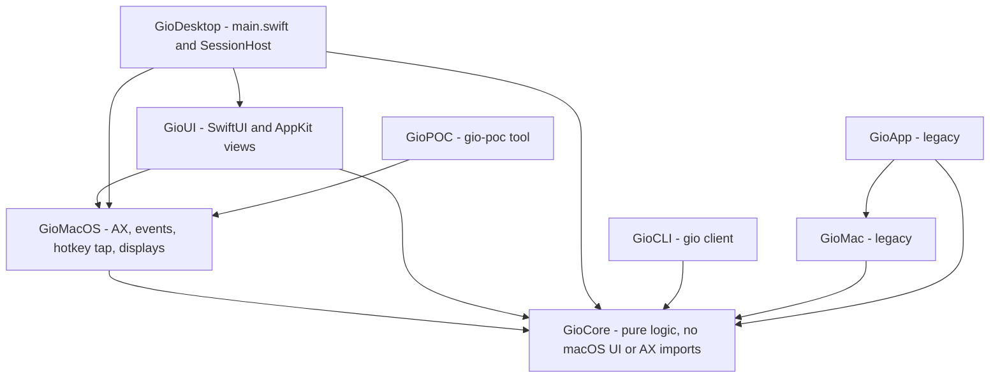
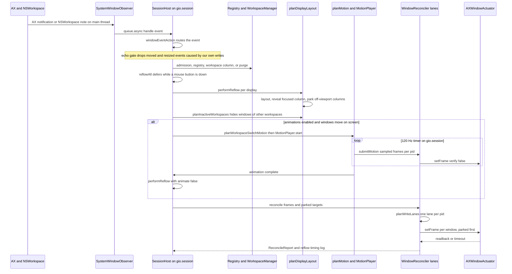
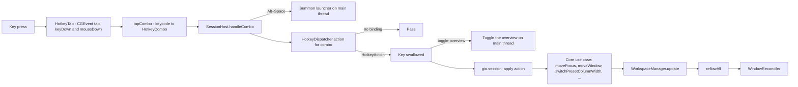
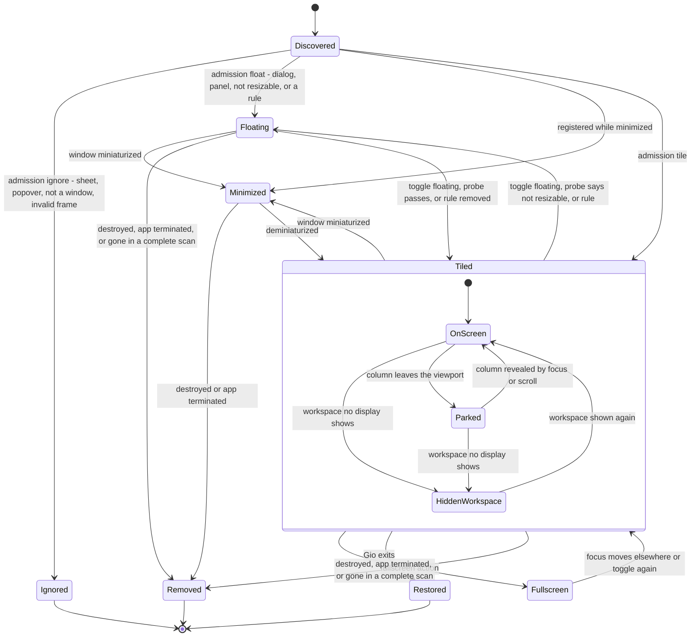
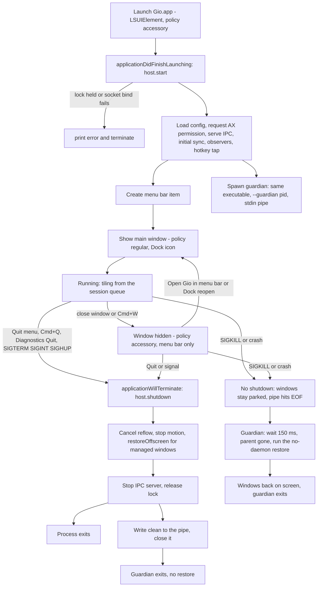

# Architecture

This document explains how Gio is put together, which rules keep it correct, and how a macOS event becomes a window movement. Every claim was checked against the code at the time of writing; where behavior is legacy, unfinished or unverified live, the text says so.

Contents: [Modules](#modules-and-dependency-rules) · [Invariants](#core-invariants) · [State model](#state-model) · [Event pipeline](#event-pipeline) · [Layout details](#layout-details) · [Hotkeys](#hotkey-flow) · [Window lifecycle](#window-lifecycle) · [App lifecycle](#app-lifecycle) · [Coordinate spaces](#coordinate-spaces) · [Concurrency](#concurrency-model)

## Modules and dependency rules

| Target | Kind | Depends on | Role |
| --- | --- | --- | --- |
| `GioCore` | library | none | All decisions: window registry, workspaces, layout, viewport, focus, move/resize, parking, motion planning, reconciler, hotkeys, config, rules, IPC, logging, recovery. Imports only `Foundation`, `CoreGraphics`, `Dispatch`, `Darwin`. |
| `GioMacOS` | library | `GioCore` | macOS adapters: Accessibility discovery and events, `AXWindowActuator`, the `CGEvent` hotkey tap, display snapshots, restore/tile assemblies. |
| `GioUI` | library | `GioCore`, `GioMacOS` | SwiftUI/AppKit: main window, menu bar, launcher, settings views and their view models. |
| `GioSession` | library | `GioCore`, `GioMacOS` | Session-queue components extracted from `SessionHost`: `FocusRingPublisher`, `FocusDimPublisher`, `GatedStatePublisher` (menu bar), `SessionFactsBuilder`, `RenderVerifier`, `ConfigCoordinator` (reload, config edits, the locked hotkey table, tap restart decision), `IPCRouter`, `SnapshotFlightController` (behind `OverlayPort`), `SnapshotCacheRefresher`, `NativeZoomController`, `MotionDriver` (player, display-rate timer, animating pids), `FocusCoordinator` (adoption with click settle and validation, keyboard intent, centering, cursor warp, focus-follows-mouse; click and pointer hand-offs under their own locks), `WindowEventRouter` (observers behind the `EventPort` protocol that `SystemWindowObserver` adopts, launch attach retry, event routing with the motion-echo, native-zoom and write-echo drops) `DiscoveryService` (scan, registration, appeared-window retry, purge, terminate, display sync) `ActionApplier` (hotkey actions onto Core use cases, returning an `ActionEffect`) and `ReflowPlanner` (the planning half of `performReflow`: every display's layout, the inactive-workspace parking with its memo and the hidden-window book, the motion and prepositions, the curve and size schedules, returned as a `ReflowPlan` value that the host applies) with `ResizeProbeRunner` and `DisplayParameters` (refresh rates and capture screens behind one lock), and the `SystemProbe` / `SessionScheduler` (`QueueScheduler`, test `ManualScheduler`) seams. Each takes a small context of closures, never the host. |
| `GioDesktop` | executable | `GioCore`, `GioMacOS`, `GioUI`, `GioSession` | `main.swift` (app delegate, lifecycle) and `SessionHost.swift` (the live session, composition root). Built by the Xcode `Gio` target as `Gio.app`, which links `GioSession` as a package product. |
| `GioCLI` | executable | `GioCore` | The `gio` client. The SwiftPM executable is named **`GioCLI`**; its usage text prints `gio`. |
| `GioPOC` | executable | `GioMacOS` | `gio-poc`: Accessibility proof of concept, one-shot tile, and `restore` recovery. |
| `GioMac`, `GioApp` | library, executable | `GioCore` (+ `GioMac`) | **Legacy** prototype from before the rewrite. Not part of the running app. |



**Dependency rules**

1. Arrows point toward `GioCore`. `GioCore` never imports `AppKit`, `ApplicationServices`, SwiftUI or any macOS UI/AX framework. The compiler enforces this because the target declares no dependencies; keep it that way.
2. Decisions live in `GioCore` as pure functions or small value types with XCTest coverage. Adapters (`GioMacOS`, `GioUI`, `GioDesktop`) translate between the OS and Core types and contain as little logic as possible.
3. `GioCore` reaches the OS only through protocols it owns (for example `WindowActuator`, `MotionFrameSink`) that adapters implement.
4. `GioUI` may import `GioMacOS` (for the Accessibility permission request) but must not touch session state directly; it receives `SessionSnapshot` values and calls `DesktopActions` closures.
5. New UI code goes in `GioUI`, not `GioDesktop` (see [CONTRIBUTING](CONTRIBUTING.md#add-a-desktop-app-section)).

## Core invariants

These are hard rules. Break one and the design stops working.

| # | Invariant | Why it exists |
| --- | --- | --- |
| 1 | **State is the source of truth.** The registry, `WorkspaceManager` and `DisplayManager` hold the logical world. Windows on screen are a projection of it. | Prevents reading positions back from apps and fighting them. |
| 2 | **`LayoutEngine` knows no macOS.** `ScrollableLayoutEngine.calculate(workspace:viewport:)` maps a `Workspace` and a viewport rect to absolute frames. No AX types, no clocks. | Makes layout deterministic and testable. |
| 3 | **Only `WindowReconciler` writes window frames.** Flow is always State, then Layout, then Reconciler, then macOS; never hotkey to AX. The reconciler diffs desired against actual and writes only deltas. | One place to enforce tolerances, lanes, timeouts and parking. |
| 4 | **Logic changes go through Core use cases.** Hotkeys and IPC verbs map to actions; actions are pure functions on `Workspace` or the registry. | Keeps behavior testable without a display. |
| 5 | **Gio never manages or actuates its own process.** | See below. |
| 6 | **Logs never contain window titles.** Log lines carry numeric IDs (`pid:elementID`), counts, timings and app names. | Privacy. Titles are kept in memory only and shown in the app, not logged. |
| 7 | **An invalid config never breaks the window manager.** Errors fall back to defaults; unknown keys and tables only warn. | The WM must keep running. |
| 8 | **Absence is not death.** A window or app is removed only on proof: a destroyed event, a terminated pid, or a vanished window in a *complete* scan of that pid. | Enumeration gaps must never wipe state. |
| 9 | **Physical writes never mutate logical state.** Animation only changes what the reconciler writes; workspace state already holds the final layout. | Animation can be cancelled or retargeted without corrupting state. |

Invariant 3 has no exceptions. Every write, including the off-screen prepositioning of incoming windows before a workspace-switch animation (`preposition`), animation frames, and restore, goes through `WindowReconciler` (`preposition`, `submitMotion`, `reconcile`, `restoreOffscreen`). Do not add direct writes.

### Why Gio never touches its own windows (commit `bac43c6`)

Once the main window made Gio a regular app, clicking it made Gio the frontmost application. Focus adoption then registered Gio's own window, and the motion lanes wrote its position through Accessibility from a background thread. AX calls on in-process elements execute AppKit code on the calling thread, which crashed inside `NSWMWindowCoordinator`. The fix refuses Gio's own pid in three places:

- `FocusCoordinator.requestAdoption` (`GioSession`) returns early for its `ownPID` (`ProcessInfo.processInfo.processIdentifier`); the FI-06 reassert never reads the own pid's focused window and focus-follows-mouse never targets a point Gio's own window covers (tested with fakes in `FocusCoordinatorTests`).
- `isManageableProcess(pid:ownPID:onlyPID:)` in `GioMacOS` filters discovery (`discoverSystemWindows`, `discoverSystemWindow`).
- `DiscoveryService.registerNew` (`GioSession`), the single registration funnel of the full scan, launch scans and appeared windows, refuses the own pid even if a discovery hands one over (tested per entry point with fake discovery and events).
- `AXWindowActuator.register` ignores handles for the own pid, so no lane can ever write them.

Any new code path that enumerates windows or adopts focus must go through these guards.

## State model

| Type | Meaning |
| --- | --- |
| `WindowID` | `pid` + `elementID`. `elementID` is assigned by the session (no stable public window number exists); identity across rescans is a retained AX handle matched with `CFEqual`. |
| `ManagedWindow` | Registry record: app name, title, last logical frame, `WindowMode` (`tiled`, `floating`, `fullscreen`), optional `FloatReason`, `isMinimized`. |
| `WindowRegistry` | Single owner of window membership (managed vs ignored). |
| `Column` | Ordered vertical stack of `WindowID`s, a `ColumnWidthSpec` (`standard`, `proportion`, `points`), optional saved width (maximize toggle) and per-window height weights. |
| `Workspace` | Horizontal strip of columns, `focusedColumn`, `focusedWindow`, `viewportOffset`. |
| `WorkspaceManager` | NF-02 dynamic vertical workspaces: an ordered stack per display, stable `WorkspaceID`s, 1-based indices that shift. Invariants after every operation: exactly one trailing empty workspace per stack, empty workspaces the display is not on are removed, the active one may be empty only until you leave it, and windows are never lost (a removed display merges its windows into a survivor). `current` is the focused display's active workspace; `stackSummaries()` feeds status, the menu bar and the Overview. NW-02 named workspaces (`applyNamedWorkspaces`, applied whenever `CommandSession.config` is assigned) carry `Workspace.name`, are never pruned, and come first in their display's stack in config order (display resolved against `mainDisplay`, which `syncDisplays(_:main:)` receives: the snapshot at the Cocoa origin); the spare is always dynamic. Reload matching: by name, else rename by position, else create; a dropped name becomes dynamic in place, so no window is lost. With no names the manager behaves exactly as before (seeded regression test). |
| `DisplayManager` / `DisplayState` | Per display: frame, which workspace it shows (mirrored from `WorkspaceManager.activeID(on:)` on every reflow), viewport. The manager owns the stacks; `syncDisplays` registers displays and merges the windows of a vanished one into a surviving stack. |

### Multiple displays (MM-01)

- **Order.** Displays are ordered by position, never by `CGDirectDisplayID`: left to right, then top to bottom (`displaysByPosition`, `GioCore/Display/DisplayGeometry.swift`). `snapshotDisplayList`, `DiscoveryService.syncDisplays`, `DisplayManager.allDisplays()` and `WorkspaceManager.displayIDs` all follow it. The main display is the primary one (Cocoa origin, `primaryDisplayIndex`); it adopts the placeholder stack at startup and takes the initial focus, whatever its position.
- **Startup placement.** `SessionHost.initialSync` registers the displays before the first scan. A full scan (startup, resync) places each new window on the display holding the largest share of its frame (`displayFor(frame:displays:)` over the usable frames, `WorkspaceManager.arrivalDestination(_:onDisplay:)`); a window on no display goes to the focused one. Named-workspace and window rules keep precedence. Live arrivals (created events, launch scans) still go to the focused display, like Niri.
- **Hidden workspaces** park below the display whose stack holds them (a stack without a connected display uses the first display), never on another display (MM-03, `hiddenTarget`): bottom-right corner, then bottom-left; when a display below overlaps both (vertically stacked displays), off the right side, then the left side, level with the display's top; when every side touches a display, the bottom-right corner of the union of all displays (at most the 1 pt sliver touches the display in that corner). `ReflowPlanner` keeps one parking memo per display.
- **Workspace-switch motion.** Each display animates its own part: the hidden windows parked below it drop, the floating windows it shows again rise. A display whose workspace did not change has nothing to carry, so with one display the behaviour is unchanged. MM-03: a display with another display in the band below it (`canSlideBelow`, the display's width, one display height deep; edges that only touch do not count) never slides through it: its outgoing windows and the windows coming from below get no pre-position and no flight and jump at the final pass (side entries and scrolling still animate).
- **Floating windows follow monitor moves (MM-03).** `ReflowPlanner` remembers which connected display's stack held each floating window at the last pass. When that display changes (`move-column/window/workspace-to-monitor`), `planFloatingRelocations` translates the window's frame (or its remembered hidden frame) by the delta between the two visible-frame origins and clamps it inside the target's visible frame, size kept (`relocatedFloatingFrame`; a window larger than the target is pinned to its top-left). The frame goes into `HiddenWindowBook` (`move(_:to:)`), so the existing shown-floating path writes it through the reconciler, keeps it across retargets until the window sits there, and a hidden window returns there. A window seen for the first time, one already centred on its new display and one whose old display is gone stay put.
- **Default column width.** `makeLayoutConfig()` is display independent: a `default-column-width` fraction stays a proportion (`LayoutConfig.defaultColumnProportion`) that each display resolves against its own viewport; points stay absolute.
- **Focus.** Actions resolve on the display showing the current workspace, else the focused display (`ActionApplier.focusedViewport`). Focusing a window on another display's shown workspace (click, activation) moves the focused display with motion cause `.passive`; only revealing a hidden workspace is a `.workspaceSwitch` (`WindowFocusPlan.revealCause`).
- **Neighbours.** `displayNeighbour(of:direction:frames:)` picks the display past an edge, preferring ones overlapping on the perpendicular axis, then the nearest edge, then the nearest centre. Used by the monitor actions (MM-02).
- **Monitor actions (MM-02).** `focus-monitor-*`, `move-column-to-monitor-*` (default `Ctrl+Alt[+Shift]+H/J/K/L`), `move-window-to-monitor-*` and `move-workspace-to-monitor-*` (unbound) are direction-parameterized `HotkeyAction` cases. `ActionApplier` resolves the target with `displayNeighbour` over the `DisplayState` frames from `manager.focusedDisplay` and calls the pure use cases `WorkspaceManager.focusDisplay(_:)`, `moveColumn(toDisplay:)`, `moveWindow(toDisplay:)` and `moveWorkspace(toDisplay:)`; each returns false and leaves the manager unchanged for a no-op (no display that way, nothing to move, a named or empty workspace for the workspace move). Column and window moves land after the target's focused column in the workspace it shows and focus follows (`focusedDisplay` changes); the emptied source stays shown until left. A moved workspace is inserted after the target's active workspace (after its named block, before its spare) and shown; the source shows the workspace below, or above when only the spare is below. A successful action sets `ActionEffect.syncsShownWorkspace` and carries a focus intent; motion causes are `.windowMovement` for column/window moves and `.workspaceSwitch` for focus and workspace moves. `focus-monitor-*` onto a display with no window to focus sets `ActionEffect.warpsToDisplay` (the target's usable frame), and the host calls `FocusCoordinator.warpCursor(toDisplay:)`, which follows `mouse-follows-focus` like the window warp; keyboard focus stays on the previous window then. No CLI verbs.
- **Not covered.** Managed-Space detection uses a marker on the primary display (secondary-display Spaces are not seen); the overview shows the focused display's stack only.

## Event pipeline

The session runs on one serial queue, `gio.session`, owned by `SessionHost`. Every mutation and every reflow happens there. A macOS event travels like this:



Stage by stage:

1. **Intake (`GioMacOS/Accessibility/WindowEvents.swift`).** `SystemWindowObserver` keeps one `AXObserver` per app (window created, focused window changed, moved, resized, miniaturized, deminiaturized, title changed, element destroyed) plus `NSWorkspace` launch, terminate and activate notifications. Events arrive on the main run loop and are forwarded to `queue.async`.
2. **Routing (`GioCore/Window/WindowEventPolicy.swift`).** `windowEventAction(for:isKnownWindow:)` is a pure table: register, remove, frameChanged, reflow, minimize, restore, updateTitle, adoptFocus, resync, ignore.
3. **Admission and registration (`registerNew`, `classifyWindowAdmission`).** Each new window is classified as `tile`, `float(reason)`, `ignore(reason)` or `suspend(reason)`. Config rules (`evaluateRules`, first match wins, by exact bundle identifier when the rule has one and the window's is known, else by exact app name) can override mode and workspace at arrival; `WorkspaceManager.arrivalDestination` picks the rule's named workspace (`open-on-workspace`), else its index, else the current one. On a live arrival (`registerAppeared`, or the one-pid scan of a launched app, never a full scan) the follow policy (`decideArrivalFollow`, `GioCore/Workspace/ArrivalFollow.swift`: `always`, `never`, or `when-active` = the window's pid is the frontmost app or was launched within 3 s, from `RecentLaunches` fed by the router's launch events) may switch to that workspace. A `when-active` arrival that does not follow at once is recorded in `PendingFollowBook`; when its app activates within 1.5 s (`DiscoveryService.appActivated`, called by the router before focus adoption) and the user is still on the same workspace with the same focus (`pendingFollowStillWanted`), the switch happens then (`window follow deferred ... reason=activated`); a purge forgets the record; the host's `followArrival` then requests the keyboard focus intent, like a focus hotkey. The window gets a fresh column on the target workspace and a per-window observer. Attributes of a brand-new window are often unreadable, so registration retries after 0.1, 0.3 and 0.8 s (`WindowRegistrationRetry`), only while the pid is a running app (`isRunning`) and never for Gio's own pid. Observer attachment to a launched app retries after 0.25, 0.5, 1 and 2 s (`ObservationRetry`).
4. **Debounce.** Events that need a rescan call `scheduleReflow`, debounced by 0.3 s (`full: true` re-enumerates; `full: false` only re-lays out). Registration, removal, minimize and restore reflow immediately.
5. **Mouse guard (`ReflowDeferral`).** While a mouse button is down, `reflowAll` polls every 50 ms and coalesces requests, then reflows once after release. Nothing moves under the cursor.
6. **Layout planning (`planDisplayLayout`).** Per display: lay out the strip, compute the minimal scroll that reveals the focused column, lay out again from that offset, then split frames into visible and parked. In real fullscreen the covering window gets the display frame and everything else parks where its column already is. `planInactiveWorkspaces` computes hidden positions for windows of workspaces no display shows.
7. **Motion.** If animation is active, `planWorkspaceSwitchMotion` (which wraps `planMotion`) picks the windows that are on screen at the start or the end and builds `WindowAnimation`s; `MotionPlayer` is driven by a timer on the session queue paced to the display (60 Hz = 16.7 ms, 120 Hz = 8.3 ms; see [Motion](#motion-and-retargeting)). See [Motion](#motion-and-retargeting).
8. **Reconcile (`WindowReconciler.reconcile`).** Windows are grouped by pid into lanes; each lane runs on its own thread. See [Write lanes](#write-lanes-and-timeouts).
9. **Actuation (`AXWindowActuator`).** Converts Cocoa frames to AX, orders position and size writes, verifies visible writes with a readback, and enforces a per-element messaging timeout.
10. **Echo suppression.** Applied frames are recorded in `WriteEchoGate`; see [Echo gate](#echo-gate).

IPC (`gio` CLI) enters the same queue: `IPCServer` calls `queue.sync { ipcRouter.handle }` (`IPCRouter`), and verbs that change state (`focus`, `move`, `workspace`, `reload`) end in `reflowAll`.

## Layout details

### Niri proportion width

A column of proportion `p` takes that share of the strip after padding:

```
width = p * (viewportWidth - 2 * padding + gap) - gap
```

So `1/p` such columns plus their gaps fill the viewport exactly. Example: viewport 1800, padding 8, gap 8, `p = 0.5` gives `0.5 * 1792 - 8 = 888`; two columns take `888 * 2 + 8 + 16 = 1800`. Widths are floored at `minimumColumnWidth` (200). `default-column-width` values up to 1 are proportions, larger values are points (`GioCore/Resize/ColumnWidth.swift`, `GioCore/Layout/LayoutEngine.swift`). The same function is used by the engine and by the width actions so what you see is what actions compare against.

### Learned minimum sizes

Apps clamp to an unpublished minimum size (asked 440 wide, got 500) and Accessibility exposes no minimum attribute. When a visible write lands with `frameMismatch` and a dimension came out larger than requested by more than 1 pt, and that growth is anchored to one edge (`learnedMinimum`), `MinimumSizeBook` records the window's minimum (maximum of everything learned). If both edges moved it was position clamping and nothing is learned. The book lives in `SessionHost`, is forgotten on purge and registration, and feeds `ScrollableLayoutEngine.minimumSizes`:

- a column is at least as wide as its widest member's learned minimum (capped to the usable viewport), so neighbours move instead of being overlapped;
- stacked heights come from `distributeHeights`: weights as before, but windows below their minimum are pinned to it and the rest re-share what is left; when the minimums cannot all fit, the plain proportional split is used;
- fullscreen windows are outside the strip and unaffected.

The first pass may fail once (`min size learned` is logged and one relayout is scheduled); the next pass lays the window out at its real size, so the write counts as already correct and `failed` returns to 0. Learning only ever raises a minimum, which bounds retries.

### Reveal and scroll

The focused column is always revealed by the smallest possible scroll (`revealOffset` with `Viewport.ensureVisible`) that keeps the layout `padding` between the column and the screen edge, like the strip's own ends (PF-H): a column scrolled in from the right stops `padding` short of the right edge, and a maximized column (`Alt+F`, width = viewport minus twice the padding) lands exactly between both paddings. A column too wide for the padding, or wider than the viewport, pins to its start. Offsets are clamped to `[0, contentWidth - viewportWidth]`. Center-column (`Alt+C`) sets the offset so the focused column is centered, clamped at the strip edges.

### Parking

macOS refuses to place a window fully off-screen, so a window that is not visible keeps a sliver inside the display (`parkingSliver = 1` point). All parking is computed against the **full display frame**, not the usable area, so a Dock inset never leaves a parked window visible.

| Situation | Where the window goes |
| --- | --- |
| Column left of the viewport | x = `display.minX - width + 1`, keeps its y and size (left edge). |
| Column right of the viewport | x = `display.maxX - 1` (right edge). |
| The preferred edge would overlap another display | The other edge is tried. |
| Both edges touch another display | Bottom-right corner: x = `display.maxX - 1`, y = `display.minY - height + 1`. |
| Window of an inactive **workspace** | Off the display whose stack holds it (MM-01), never on another display (MM-03), size kept: bottom-right corner, bottom-left if a neighbour overlaps it; with a display below overlapping both, off the right side (`edge: .right`), then the left side, level with the display's top; every side taken: the bottom-right corner of the union of all displays. Floating windows remember their frame (`HiddenWindowBook`) and return to it when their workspace is shown. |

Reconciler behavior for parked targets: written before visible windows in the same lane, never verified by readback, never focused. A landing counts as parked (`already correct`) if the size is unchanged and no more than `parkedStripLimit` (40 pt) of the window remains inside the display on the intended side, because macOS may clamp the requested position (`isParked`). A `parked clamped` debug line records this.

### Write lanes and timeouts

`planWriteLanes` builds one lane per pid. Inside a lane the order is fixed: parked targets first, then visible frames, each sorted by `WindowID`. Lanes run concurrently (`LaneConcurrency.concurrent(stallTimeout: 0.25)`).

- A lane that makes no progress for **0.25 s** is abandoned: its unfinished windows are reported as `failed` with `timeout` and the reflow returns without waiting.
- The abandoned pid stays marked busy until its thread comes back. Further writes to that pid are skipped with `timeout (previous write to this app still pending)`, so a hung app is never written by two overlapping lanes.
- `AXWindowActuator.messagingTimeoutSeconds = 0.25` is applied to each AX element (the system default is about 6 s). The same timeout affects discovery reads on slow apps.
- Per window the reconciler reads the actual frame, skips the write if it is within `tolerance` (1 pt) of the target or already parked, and otherwise calls `setFrame(_:from:for:verify:)` with the frame it already read (no second read).
- Write order in the actuator: position first when the target grows in either dimension, size first when shrinking, to avoid macOS clamping a large frame written from a small position.
- Every failed window is logged by `WindowReconciler` as `reconcile failure id= app= kind= requested= actual=` (FI-01). `ReconcileReport.failures` carries the same data structured (`ReconcileFailure`). Adapter errors report their kind through `FrameFailureReporting`, so `GioCore` stays free of adapter types. `FailureLogGate` warns once per (window, kind) and logs repeats at debug.
- Focus, when requested, is applied last, after every lane (a pass dispatched under a snapshot overlay runs it on the focused app's lane instead, SM-12, see Snapshot pipeline). `SessionHost.performReflow` passes a focus target only when a keyboard or IPC action left a `FocusIntent` (focus, move, workspace, consume/expel, fullscreen). The target is focused and raised after its frame is written; during an animation it is held until the final exact pass. Passive reflows (AX events, click adoption, reload, rescans) pass `nil` and never steal focus. `FocusIntent` also ignores trailing activation events that contradict a fresh intent, and a mouse click cancels it.

### Motion lanes

PA-05. Animation frames do not go through the reflow lanes. `WindowReconciler` owns one **persistent serial lane per pid** (`MotionLane`, a serial `DispatchQueue` created on the first frame for that app and reused across frames and reflows). Each lane has a single **pending-frame slot** (`MotionSlot`):

- `submitMotion` stores the newest target for the app and schedules the lane only if it is idle. No worker, group or per-frame closure is allocated; the lane's drain block is built once.
- If the lane is still busy, a not-yet-started frame is **overwritten** (latest wins). The overwritten frame counts as a drop (`MotionWriteStats.drops`, added to `dropped` in `anim done`). Overwriting merges per window and keeps the oldest `from`, so an attribute change of a dropped frame (the first-frame shrink of FI-03) is never lost.
- The lane claims the pid in `LaneExecutor` while it runs, so a reconcile lane and a motion lane never write the same app at once. `submitMotion` returns false only when an abandoned reconcile lane still holds the app.
- Completion is a per-pid busy count and one condition, not a `DispatchGroup` per frame. `MotionPlayer.finish` never waits on the lanes (PF-A: a slow app's in-flight write used to hold the session queue and stretch `anim done duration` by up to 300 ms; live, Music at 251 ms turned 367 ms into 636 ms). The final exact pass waits only for the apps it writes and only `finalPassMotionGrace` (100 ms); an app still writing after that has its pending frames discarded and its windows reported in `ReconcileReport.deferred` (not failed, not trusted). `DeferredSettle` (`GioSession`) polls those apps every 30 ms and runs one more final pass once they are idle, or at 600 ms regardless (`settle deferred timeout`); a motion that starts meanwhile settles them itself. `waitForMotionIdle(timeout:)` (all lanes) remains for switch prepositions, nudges, shutdown and restore-all.
- A lane is torn down by `forgetApp(pid:)` (called from `DiscoveryService.appTerminated`): it is removed from the registry, an in-flight write finishes, and a later frame for a reused pid gets a fresh lane.

### Motion and retargeting

- `planMotion` animates a window only if its start frame **or** its target frame is on screen (more than two parking slivers inside the viewport). Typically 2 to 4 windows; parked-to-parked moves jump in the final pass.
- Start frames come from `physicalFrames`, the last frame Gio applied or sampled. A window with no known frame is read once (`learnPhysicalFrames`) so new windows can slide in.
- `MotionPlayer.start` on a run in flight **retargets**: new animations replace the old ones starting from the sampled frames and the clock restarts, while the run's counters continue, so nothing snaps back.
- **Position only (FI-03).** The player writes `WindowAnimation.motionFrame(at:)`, not the full interpolation: the origin follows the easing, the size never interpolates. A dimension that shrinks takes its new value from the first frame, so the window leaves its neighbours' way before anything moves. A dimension that grows keeps its old value for the whole flight, including the last tick, and the final exact pass applies it once the neighbours have moved. Mixed changes (one grows, one shrinks) split accordingly. Every frame after the first is therefore position-only: one Accessibility write per window per frame instead of two. Workspace-switch flights already keep a constant size (`slideDownFrame`). `preposition` still writes the full target frame, because the window is entirely below the display at that moment and cannot overlap anything.
- **Renderer choice (SM-01).** `[animations] renderer = "snapshot" | "ax"` (default snapshot). `effectiveRenderer(config:permission:)` (`Animation/RendererChoice.swift`, pure) yields `.snapshot` only when configured and `CGPreflightScreenCaptureAccess()` is true, else `.ax`; `RendererLogGate` logs `renderer effective=... reason=...` once per change from `sessionFacts()`. The permission is published in `SessionFacts.screenRecordingGranted` and shown in Overview and Diagnostics; the request (`CGRequestScreenCaptureAccess`, `GioMacOS/Accessibility/ScreenRecordingPermission.swift`) runs on main and only from the "Request access" buttons, never at launch.
- **Snapshot capture (SM-02).** `GioMacOS/Snapshot/SnapshotCapturer.swift` captures managed windows (`SCScreenshotManager.captureImage` with `SCContentFilter(desktopIndependentWindow:)`, size = points x backing scale, no cursor, no shadow) and one backdrop per touched display (`SCContentFilter(display:excludingWindows:)` leaving out the animated windows and every Gio-owned window) concurrently, under an overall budget (`SnapshotBudget.defaultMilliseconds` = 45); unfinished work is reported as misses and dropped. `SCWindow.frame` is global, top-left origin (like CoreGraphics bounds), so windows are matched against `CGWindowListCopyWindowInfo` bounds flipped to Cocoa (`windowServerSnapshotCandidates`) using the FI-05 rule (exact frame per pid, then unique same size, ambiguous skipped; `matchSnapshotCandidates`, pure) and joined to ScreenCaptureKit by `CGWindowID`, so the cached, stale `SCWindow` frames are never compared. `SCShareableContent` is cached and refreshed only when the managed set changes or a wanted window is missing. `SCScreenshotManager` needs macOS 14 (package target is 13): older systems report every window as a `failed` miss. Images are never cached; the result owns them. Logs: debug `snapshot window id=pid:element ms=`, info `snapshot capture windows=N captured=M backdrop=<bool> ms=T misses=K`. The motion uses it through the pre-captured cache (see [Snapshot pipeline](#snapshot-pipeline-sm-03sm-17)); Diagnostics also has a "Test snapshot capture" debug button (off the hot path). After SM-02c the matching has a third pass: with no exact and no same-size candidate, the unique unclaimed same-pid candidate overlapping at least 80% of the larger frame's area matches (an app that learned a larger minimum size, e.g. AX 888 wide vs 900 drawn); several such candidates stay ambiguous.
- **Adaptive size (PA-06).** FI-03 is the default (`[animations] resize = "never"` since SM-00, because the adaptive first attempt made the growing app relayout every frame), not the only mode. `WindowAnimation.sizeSchedule` (`none`, `fromStart`, `from(t0)`) lets a growing dimension interpolate during flight; shrinks still land on the first frame. `planSizeSchedules` (`Animation/SizePlanner.swift`, pure) grants a schedule only when (a) the app passes `ResizeCapability` (or `[animations] resize = "always"`) and (b) sampling 5%..95% of the flight shows no overlap (more than 1 pt on both axes) with any other animation's own `motionFrame`; if a neighbour is in the way early, the grow is delayed to the first 5% step at which it clears and still lands exactly at t = 1. Windows are decided in id order against already-decided schedules; non-animating windows are not obstacles (the layout never overlaps them). Size progress is the origin's normalized progress (easing fraction, or for springs `1 - x(t)/x(0)` on the dominant axis, clamped), so size and position arrive together; without origin travel it is ease-out over the duration. `ResizeCapability` (keyed by app name) keeps an EWMA (alpha 0.4) of per-frame write cost and drop rate from `MotionSummary.appStats`, fed after each `anim done`; an app qualifies with cost at most 4 ms, drops at most 10% and 2+ usable motions (3+ writes each), so unknown apps stay on FI-03 until learned. A learned minimum size (frame mismatch, FI-02) blocks it for 5 motions. The lanes are unchanged: a dropped size frame is merged into the newest one and the final exact pass still sets the exact size. `anim done` gains `sizeAnimated=N`; capability changes log at debug.
- **Focused grow at start.** With real windows, the focused window that maximizes, goes fullscreen or takes a wider preset looked cut: neighbours slid away first and it jumped to its size at the final pass. `SizeSchedule.atStart` writes the final size of a growing window in the first frame (one size write, so one app relayout) and only the origin flies afterwards; `sizeProgress` is 1 from t = 0, shrinks are unchanged. `planSizeSchedules(..., focused:, focusedGrow:)` applies it to exactly one window: the keyboard focus-intent target (`FocusIntent.pendingTarget`, the window FI-06 raises at motion start; for the sizing actions that carry no focus intent, maximize and the width presets, `HotkeyAction.growsFocusedWindow` marks the already frontmost focused window instead), when it grows and is still on FI-03 after the adaptive pass. `SessionHost` calls `focusNow` before the session queue serves the first motion tick, so the size write lands on an already frontmost window and may overlap the neighbours during the flight. Without either (AX events, click adoption, reload, rescan, IPC actions that carry none) nothing is `.atStart` and FI-03 applies. `[animations] focused-grow = "start" | "end"` (default `start`; `end` restores FI-03). `anim done` gains `grewAtStart=N` (not counted in `sizeAnimated`).

  | Window in a motion | `resize = never` | `resize = adaptive / always` |
  | --- | --- | --- |
  | Focus target, grows, `focused-grow = start` | `.atStart` | the planner's `.fromStart` / `.from(t0)` if granted, else `.atStart` |
  | Focus target, grows, `focused-grow = end` | FI-03 (final pass) | the planner's schedule if granted, else FI-03 |
  | Any other growing window | FI-03 (final pass) | the planner's schedule if granted, else FI-03 |
  | Any window, shrinking dimension | first frame | first frame |
  | No focus target (passive reflow) | FI-03 | the planner's schedule if granted, else FI-03 |
- **Native zoom for maximize (NZ-01).** A size Gio has never written to an app can take 330-750 ms to appear (`resize latency ... first=true`), while the app's own zoom animates in-process. When `apply(.maximizeColumn)` toggles a **single-window** column, `nativeZoomRequest` (`Animation/NativeZoom.swift`, pure) records the window and whether it is a maximize or a restore, and `nativeZoomEligibility` decides: `[animations] native-zoom` on, one window in the column, the window grows (restore: the maximize was a native one, its accepted frame is still in force), AX renderer with animations on, a usable zoom button and a WindowServer entry to watch. Then `NativeZoomBook.begin` takes the window out of this pass's motion and writes, the neighbours animate as usual, and after `focusNow` the host presses the zoom through `WindowReconciler.pressZoom` (the app's lane; `AXWindowActuator.pressZoom` performs `AXZoomWindow` on the `AXZoomButton` element, or `AXPress` only on a real zoom button, never `AXPress` on a full-screen button). `NativeZoomSettleTracker` polls `CGWindowListCopyWindowInfo(.optionIncludingWindow)` every ~16 ms: settled when the bounds changed and then stayed unchanged for a 150 ms quiet period after the last change (multi-stage app zooms pause for tens of milliseconds between stages) and at least 120 ms after the press, timeout 1.5 s. A press that errors with a timeout-class AXError (`kAXErrorCannotComplete`, -25204; `nativeZoomActionErrorClass`) or whose lane is abandoned for stalling is `pending`, not a failure: the app is busy running its ~250 ms zoom, so `nativeZoomPressDisposition` keeps watching and Gio never writes that window (the zoom button also gets a 1.0 s messaging timeout instead of the 0.25 s per-window one). Only definitive errors (unsupported action, invalid element...) fall back at once, logging `fallback(pressFailed:<axerror>)`. The window's moved/resized/focus events are dropped meanwhile (`nativeZoomDropsEvent`) and its focus ring is hidden. The verdict is taken by the next reflow (`judgeNativeZooms`, right after the motion's final pass when one runs) against the layout target of that moment: `nativeZoomOutcome` calls the result `exact` when every edge is within 2 pt of the target and the frame is inside the display's visible frame (`physicalFrames`, `TrustedFrames` and `WriteEchoGate` take the zoomed frame; `NativeZoomBook.applyAccepted` substitutes it for the layout target while the target is unchanged, so later passes find the window correct and never write a new size), every other settled frame gets ONE correcting write to the exact target (the app zooms to the full visible frame, so this insets it back to the tiling gaps): `corrected` within 96 pt, `fallback(mismatch)` beyond (same write, different log reason); timeout or no change is `fallback(timeout|unchanged)`. After any such write `NativeZoomVerifier` re-checks the WindowServer bounds ~250 ms later (once more after the quiet period if they are still moving); if the window is not at the target (2 pt) or the write failed (app busy) the target is written ONE more time (`native zoom reassert id= app= reason=overwritten|writeFailed`, never more than once per zoom), and the window's events stay suppressed (`NativeZoomBook.isVerifying`) until the check ends. A moved layout target, a parked window or a non-echo frame event drops the acceptance. Log: `native zoom id= app= action=maximize|restore result=exact|corrected|fallback(reason[:axerror]) ms= settleMs= verified=<bool>`. The session side (request, plan, press, settle poller on a strict scheduler timer, verdicts, verification and the reassert, the WindowServer id cache) is `GioSession.NativeZoomController`, driven by the scheduler seam and closures for the probe and the reconciler.
- **Frame pacing (PA-03).** The timer interval comes from the display that holds the moving windows: `motionRefreshRate` picks the fastest `NSScreen.maximumFramesPerSecond` among the displays containing any animation's start or end frame (60 when unknown), and `frameInterval(for:)` clamps it to 30...120 Hz. The refresh rates are read on the main thread (`snapshotDisplayRefreshes`, at start and on every screen-parameter change) and published to the session behind a lock (`GioSession.DisplayParameters`, shared with the capture screens); the session queue never queries AppKit for them. The interval is fixed when a motion starts. The timer, the player and the tick are `GioSession.MotionDriver` (a strict `SessionScheduler` timer; the tick reports sampled frames through stored context closures, no per-tick allocation beyond the player's sample).
- **Per-frame cost (PA-03).** Sampled origins are rounded to whole points (sizes stay exact; whole points chosen over the 0.5 pt backing grid because sub-point steps are invisible and the AX writer ignores them). The player's "differs" test uses the writer's tolerance (`frameWriteTolerance`, 1 pt), so a delta the writer would skip is never submitted. Motion write timings are aggregated in place per pid (`MotionWriteStats`: count, sum, max, drops), app names are resolved once per pid by `AppNameCache` (only for the slowest app when the run finishes, and once per pid when a reflow report is folded), and `AXWindowActuator` counts AX calls only while the log level is debug (`countsCalls`).
- Each timer tick samples every animation by elapsed time (late ticks stay honest) and hands the changed frames to `submitMotion`, one submission per pid. `submitMotion` never blocks (see [Motion lanes](#motion-lanes)).
- When the last animation completes, `performReflow(animate: false)` runs the exact final reconcile with verification.
- If a mouse button goes down mid-flight the animation is abandoned, `InstantPlacementGate` is armed (`.mouse`) and the deferred reflow finishes instantly after release.
- **The first layout of a session is instant.** `InstantPlacementGate` (`GioCore/Animation/InstantPlacement.swift`, pure) starts armed for `.startup`, so the first `performReflow` after launch or `gio restart` writes every window straight to its tile (no fly-in from the pre-Gio positions); it is armed again (`.permission`) when Accessibility is regained and the session rebuilds. The latch is consumed by the next pass that actually runs (a deferred or coalesced reflow keeps it armed); later passes animate normally. Log: `layout instant reason=startup|permission` (info), `reason=mouse` (debug).
- Curve (NF-04): by default every flight is a Niri-style spring (`Animation/Spring.swift`, mass 1, damping ratio 1.0, stiffness 800, solved analytically for under, critically and over damped cases). `WindowAnimation.duration` is the time the spring needs to settle (displacement and velocity under `max(epsilon * travel, 0.5 pt)`, hard cap 1 s), and the final sample is pinned to the target. `MotionPlayer.start` on a run in flight hands each spring the origin velocity its predecessor had at the last sampled tick, so a retarget is continuous in position and velocity. `[animations] curve = "ease-out"` restores the old easings: `easeOut` for scroll and focus moves, `easeInOut` for workspace slides, default duration 200 ms.
- Keyboard bursts (FI-06): while a motion is in flight `ReflowCoalescer` defers the retargeting reflow to the next timer tick, so N rapid actions cost one reflow per tick. Focus for keyboard/IPC actions is applied right after the motion starts (`FocusIntent.takeImmediate` and `WindowReconciler.focusNow`); the final exact pass re-asserts it only if focus drifted (`takeReassert`): another app frontmost, or the frontmost app's `AXFocusedWindow` resolves to a different window or cannot be read (once per intent).
- Workspace switches move vertically through the bottom edge (macOS cannot place windows above the menu bar): outgoing windows drop below the display, incoming hidden windows rise from directly below their target after an invisible pre-position write.

### Transition coverage (NA-01)

Audit of the AX renderer (`renderer = "ax"`, or snapshot without Screen Recording) before NA-02..NA-04. Every row reaches `reflowAll()` and then `performReflow(animate: true)`; only `InstantPlacementGate` (startup, permission regain, mouse abandon) or `[animations] enabled = false` makes a pass instant. With the snapshot renderer the same animations fly as overlay images instead.

| Transition | Path | Before NA-02/NA-03 |
| --- | --- | --- |
| Window open (appear, launch) | `registerAppeared` / `appAttached` → `registerNew` (new focused column) → `reflowAll` | Animated. Neighbours slide. The new window is read once (`learnPhysicalFrames`) and flies from wherever the app put it, at the app's size; a grow waits for the final pass (FI-03). A target in a parked column or on a hidden workspace is written in the final pass only. |
| Window close (destroyed, app quit, vanished on a complete scan) | `purge` → `reflowAll` (destroyed and terminate: immediate, not debounced) | Animated: neighbours glide into the gap; focus follows `stripWindows` (passive, no OS focus call). The closed window itself cannot move (it no longer exists). |
| Move column, move window, consume/expel | `ActionApplier` → `reflowAll` | Animated (focus intent, FI-06). |
| Width presets, grow/shrink, maximize, fullscreen | `ActionApplier` → `reflowAll` | Animated; the focused window that grows gets its size in the first frame (`focused-grow = start`); single-window maximize uses native zoom (NZ-01). |
| Move window to workspace | `ActionApplier` → `reflowAll` | Animated: the window becomes hidden and drops below the display (NC-07); the other windows glide. |
| Workspace switch | `ActionApplier` → `reflowAll` | Animated vertically (NC-07). |
| Minimize / restore | `applyMinimized` → `reflowAll` | Animated: neighbours close or open the gap; macOS animates the minimized window itself; a restored window flies from its last known frame. |

Gaps closed by NA-02 (open entry), NA-03 (close ghost) and NA-04 (per-animation tuning).

- **Window open entry (NA-02).** `DiscoveryService.registerNew` reports every visible (not minimized) arrival (`windowOpened`) into `WindowOpenBook` (`GioCore/Animation/WindowOpenMotion.swift`, pure). The next pass that runs takes the set: an instant pass (startup, permission regain, mouse, animations off) just places the windows; an animated pass hands it to `ReflowPlanner`, which plans an entry with `planWindowOpenEntries` for each new **tiled** window whose target is in view on its display (not parked, not on a hidden workspace, frame known). The entry is a pre-position write to `windowOpenStartFrame`: the final size (one size write, like focused-grow at start) with the origin `offset` points lower (default 24, at most a quarter of the window height). The start frame may hang past the display's bottom edge (macOS refuses only the top; NC-07 relies on the same) but never onto a display below, where it stops at the edge. The spring then moves the origin only, together with the neighbours sliding to make room. An offset of 0 writes the tile directly without a flight. With the snapshot renderer the pre-position is not written (the overlay draws the flight).
- **Window close (NA-03).** The purge-triggered reflow is an ordinary animated pass (see the table): the neighbours glide into the gap with the spring and focus follows `stripWindows` (passive). The optional **close ghost** is off by default (`[animations.window-close] ghost = true` enables it). `DiscoveryService.purge` reports the ids (`windowsClosing`) before the registry, the physical frames and the image cache forget them; `CloseGhostController` (`GioSession/Snapshot`) asks `closeGhostFrame` (`GioCore/Snapshot/CloseGhost.swift`, pure): ghost on and animations active, window not minimized and in view, and a cached image taken at the frame it still had (within 2 pt) and at most 120 s old. It then shows at most four ghosts at once through `CloseGhostPort`: `CloseGhostOverlay` (`GioUI`) opens one borderless, click-through, non-activating panel exactly the window's size (never a full-screen backdrop, SM-07) at level `.normal + 1`, fades it out while it shrinks 6% around its centre over 150 ms, and removes itself; the controller's one-shot watchdog removes it too (idempotent), and shutdown removes all. No image, no ghost. Images come from the snapshot cache, which exists only with Screen Recording granted. With the ax renderer the cache would otherwise be dropped; while the ghost is on, `SnapshotCacheRefresher` keeps a light cache (`ghostCacheWanted`) of the windows in view only (no neighbour columns, no adjacent workspaces), captured by the same one-shot refresh after a settle: no periodic work.
- **Per-animation settings (NA-04).** `[animations.<name>]` tables with Niri's names (`AnimationKind`, `GioCore/Config/AnimationKinds.swift`): `horizontal-view-movement`, `window-movement`, `workspace-switch`, `window-open` (+ `offset`, 0-200 pt), `window-close` (+ `ghost`), `window-resize`. Each may set `enabled`, `curve`, `duration-ms`, `spring-damping-ratio`, `spring-stiffness` (same validation and clamping as `[animations]`); anything unset inherits (`AnimationsSectionConfig.resolved(_:)`). Global `enabled = false` turns every kind off; a kind's `enabled = false` only that one. The subset TOML parser accepts these dotted headers (other `[animations.*]` names warn and are ignored); `patchGioConfig` inserts a new dotted table right after its `[animations]` family and drops one left empty by a removal. **Classification:** the host notes a `MotionCause` in `MotionCauseLatch` (hotkey/IPC action via `motionCause(for:)`, `windowOpened`, `windowsClosing`); the next pass that runs takes it. Coalesced causes keep the dominant one (workspace switch > resize > move > view scroll > close > open > passive). The whole pass uses the cause's kind (passive reflows use `window-movement`; a disabled cause kind makes the pass instant), except that `ReflowPlanner` classifies new-window entries as `window-open` and windows crossing the bottom edge (risers and hidden drops) as `workspace-switch` (`ReflowPlan.kinds`, `classifyAnimationKinds`). `ReflowPlanner.applyingAnimationSettings` then gives each flight its kind's spring, or its ease-out duration; a disabled kind inside an animated pass lands by the second tick instead of waiting behind the others for the final pass. The snapshot overlay flies with the cause's spring. Native zoom's own animation belongs to the app; its neighbours follow `window-resize`. The close ghost's fade is fixed (150 ms) and shows only while `window-close` is active. UI: Animations settings, "Per-animation" card (a switch and a "Custom" disclosure per kind; not custom shows "Inherits global"; custom reveals curve, parameters and the motion preview; window-open adds the rise offset, window-close the ghost).

### Trusted frames and the lean settle (PA-04)

The final exact pass used to read AX frames (two calls) for every window, parked ones Gio itself placed included. `TrustedFrames` (`GioCore/Reconciliation/TrustedFrames.swift`) remembers the frame Gio wrote and verified, or found correct, for each window. `WindowReconciler.reconcile(..., trusted:)` skips the read and the write of a window whose desired frame equals its trusted frame within 1 pt (parked to parked, hidden, and unchanged visible windows) and counts it `already`; `ReconcileReport.skippedReads` and the debug lines `reconcile ... skippedReads=N` / `settle skippedReads=N` report how many. Trust is recorded after each settle (`recordSettle`: applied, parked and already-correct windows are trusted at their desired frame) and dropped by:

- a non-echo moved/resized event for the window (user drag, app-initiated resize), minimize/restore, purge and re-registration;
- a failed, vanished or timed-out report (so learned minimum sizes and failure reporting are unchanged: a clamped visible write fails, is not trusted, and is read again);
- the start of a motion or a pre-position that moves it (motion frames are unverified, so animated windows are still read in the final pass);
- any display topology change (all trust cleared; macOS may relocate windows and every parking target changes).

Known limit: a window moved by something that raises no AX event, or moved by the user inside the 0.35 s echo suppression window, stays trusted until the next event or motion for it.

Per-tick bookkeeping is in place: a motion tick updates `physicalFrames` and the echo gate only for the windows sampled that tick (no dictionary merges), and publishes the focus ring only when the focused window was sampled. `FocusRingPublishGate` further drops a publication unless visibility, style or the frame (by at least 1 pt on any edge, measured against the last published frame) changed. While a motion runs, moved/resized events from pids that are being animated are our own writes and are dropped first thing (`dropsAsMotionEcho`), before the handle lookup and the echo gate.

Retained AX handles are indexed by `CFHash(element)` (`HandleIndex`): `AXWindowActuator.id(matching:pid:)` looks up the bucket and verifies with `CFEqual` and the pid inside it, instead of scanning every handle under the lock. The hidden-window parking plan (`planInactiveWorkspaces`) is memoized (`PlanMemo`) on its inputs (hidden frames, display frames); a change of membership, frames or displays recomputes it, and config reload and display changes invalidate it explicitly.

### Echo gate

Gio's own writes raise moved and resized events. `WriteEchoGate` records every applied frame with the system uptime. An event for that window is ignored if it arrives within **0.35 s** of the write (the AX read is skipped entirely) or if the window's observed frame is within **2 pt** of the last applied frame. A write dispatched under a snapshot overlay (SM-13, `recordDispatched`) is suppressed until its latest possible landing plus 0.35 s; the flight's settle records it again once the lanes returned. Overlay flights do not gate events by pid (`dropsAsMotionEcho` covers only the AX motion's `animatingPids`), so the echo gate is the only guard there. Without this, write, event, reflow, write would loop.


### Snapshot pipeline (SM-03..SM-21)

With the snapshot renderer the real windows move once and a Core Animation overlay draws the motion. SM-08 made it the primary motion path: the overlay goes on screen before the real windows move, draws the captured desktop, the window shadows, the focus ring or dim, and comes down with no fade.

```
settle (any reflow that ends still)            keypress -> performReflow (animating)
typing / 3 s focus / new window (0.6 s)                |
        |                                              |
        v  300 ms debounce, one-shot                   v  SnapshotFlightController.drive (session queue)
SnapshotCacheRefresher.schedule                 planSnapshotFlight  --no moving image / backdrop--> AX motion
        |  only missing / resized / dirty /            |            (log: snapshot fallback reason=... ids=N,
        v  soft-stale images + stale backdrop          |             next refresh scheduled)
SnapshotCache<CGImage>  <- images, backdrops           v  OverlayPort.beginFlight (hop to main): PRIME
  visible + adjacent columns                    SnapshotOverlay: opaque picture (panel not opaque) + backdrop + shadow,
  + focused window of adjacent workspaces         image, dim and ring layers at their START frames; orderFront, flush
  + coverage: every workspace, <=12 per run            |
  2 sizes per window, LRU, cap 8 display-fulls         |
                                                       v  snapshotPrimed(ok) (hop back; ok=false -> AX motion, no write yet)
                                                       |  instant pass: ONE write of each real window, DISPATCHED (SM-12)
                                                       v  OverlayPort.flyFlight: keyframe tracks from Gio's spring (render server)
                                                layers landed (spring deadline) AND final pass settled  (SnapshotFlightGate)
                                                       |
                                                       v  collect writes -> HOLD until painted (SM-14, <= 300 ms)
                                                       |  -> ring + dim (no fade) -> overlayEnd -> render check, cache refresh
```

- **Cache (`SnapshotCache`, pure).** Keyed by `WindowID` with frame, capture time, last use and pixel count; images are `CGImage` held by the session. After each settle one background run (`SnapshotCacheRefresher.refreshSet`, `GioSession`) considers the visible columns, the column just left and right of them and the focused window of the workspaces above and below (at most 12 windows). No periodic timer: a burst of settles is debounced to one run, and a run that finds another capture busy asks for one more. Eviction: windows that closed or minimized (`retain`), then until the total is within `snapshotCacheCapPixels` (SM-20: 8 x the largest display in pixels, backdrops counted but never evicted) `enforce` removes images of windows outside the refresh set first (SM-13: hidden-workspace coverage never evicts the windows on screen and next to them), within each group sizes the window is not at now (its physical frame) before its current size, least recently used first. SM-21: the current-size images of the shown strips (`pinned`, every tiled, non-minimized window of a shown workspace) are never evicted; when they alone exceed the cap it yields (debug `snapshot cache cap exceeded by strip images=N`, once until the cache fits again). An entry is usable only if it is at most `snapshotMaxAge` (180 s) old and its size still matches the window (`snapshotEntryUsable`); otherwise it is a miss. SM-11: up to two images per window (`snapshotSizesPerWindow`), one per size (2 pt tolerance; the latest capture of a size replaces it, a third size replaces the window's least recently used one), so Alt+F toggling keeps both. A flight takes `usableEntry(id, startFrame:)`: the image of the start size within the max age, else the newest image of the other size if younger than `snapshotSoftAge`, flown scaled (the layer scales to its bounds; debug `snapshot scaled id=P:E`), else a miss (`SnapshotCacheRefresher.flightImage(_:startFrame:at:)`, a lookup; SM-13: the flight looks each window up once at one `now`, decides the plan with that image and flies exactly it, `flies` marks that size used). Every image counts against the cap. **Pruning (SM-20).** Live (2026-10-08) the cache held 307 MB (`pixels=68346128 backdropPixels=8416800`) although images older than the max age never fly. Every settle run first calls `SnapshotCache.prune` (pure): it drops an image of the window's current size (its physical frame) older than `snapshotMaxAge`, an image of another size older than `snapshotSoftAge` (it only flies scaled within that age), any image older than the max age when the window has no physical frame, and the backdrops of displays that are gone (debug `snapshot cache pruned images=N reason=<age|size|display>`, one line per reason). Kept images are exactly those `usableEntry` can still return from the current frame; a backdrop of a shown display always stays. Pruned windows stay `tried`, so coverage does not capture them again in a loop; the refresh set (visible windows, next columns, focused windows of adjacent workspaces) keeps its freshness rules and captures a pruned image again as missing. **Memory pressure (SM-20).** `SessionHost.watchMemoryPressure` installs `DispatchSource.makeMemoryPressureSource(eventMask: [.normal, .warning, .critical])` on the session queue (event-driven, no timer, cancelled at shutdown) and hands each event to `SnapshotCacheRefresher.noteMemoryPressure` -> `SnapshotCache.relieve` (pure). SM-21 (live 2026-10-08: a system-wide `warning` on a 24 GB Mac with 44 % free purged 7 images and the next flights showed 43 holes): a warning is not a purge; the shown workspaces' and their stack neighbours' windows keep every image, other windows lose only images no flight can use or would use second (another size, or past the max age without a frame). Critical keeps the shown strips' images of their current size. Both keep the backdrops of shown displays (info `snapshot cache pressure level=<warning|critical> freed=N`, images). Normal after either logs info `snapshot cache pressure level=normal` and schedules one settle-like run (recovery). **Cap (SM-20).** 8 display-fulls, backdrops counted: the heaviest typical flight set (shown workspace in the middle of three, every window display-size: visible column, both neighbour columns, both adjacent focused windows, plus the backdrop) is about 6 display-fulls (`testTheVisibleAndAdjacentSetOfAThreeWorkspaceSetupFitsUnderTheCap`), leaving 2 for coverage.
- **Cache freshness (SM-09).** A run captures only what `snapshotRefreshSelection` (pure) picks: windows with no image, whose size changed (a moved window keeps its image), marked dirty, or older than `snapshotSoftAge` (30 s); a settle with everything fresh captures nothing (`snapshot refresh skipped wanted=N fresh`). Dirty signals schedule a one-shot targeted run 0.6 s later that captures only the dirty windows: typing (the hotkey tap reports every key-down that reaches an app; `SessionHost.noteTyping` forwards at most one hop per 0.5 s, `snapshotTypingHopDue`; the session marks the focused window), a long focus (SM-11: `publishFocusRing` -> `noteFocus` arms a one-shot 3 s check, `focusDwell`, cancelled by the next focus change; a window still focused then is likely in use and becomes dirty with `reason=focus`; a focus change alone changes no content and captures nothing), window registration (`noteRegistered`, so the placing settle captures the new window with `reason=new`). Dirty marks survive a run deferred by motion and are taken by the next settle; a mark of a window that can no longer be captured (minimized, floating, gone) is dropped at the next run, so the set drains. **Strip coverage (SM-21).** The shown strips are always covered: a settle run (after the refresh set) also selects every strip window, all columns of every shown workspace (`stripPlan`), without a usable image of its current size (`snapshotStripSelection`, pure: none, only another size, past `snapshotMaxAge`, or dirty), whether it was tried before or not; parked misses (known blank/unmatchable parked windows) are excluded. Staged like coverage (12 per run, one-shot 0.3 s stage while a strip window lacking an image was not asked for since the last settle, `stripPass`; a stage never asks a window twice, so one that keeps missing waits for the next settle). Adjacent and hidden workspaces keep the SM-11/SM-20 rules. **Coverage (SM-11).** A settle run also fills its budget (`maxWindows` = 12 per run) with the windows of every workspace of every stack (`coverageSet`: tiled, non-minimized, the workspaces nearest the active one first) that have no image yet; while some remain the next stage is scheduled 0.3 s after the run (one-shot; the run never starts during motion or a flight, the next settle resumes it). Each such window is tried once until it registers, moves to another workspace, shows again or (SM-20) its workspace becomes shown or adjacent to a shown one in its display's stack (so a pruned hidden image comes back before a switch can need it), so a window that cannot be captured does not keep a stage alive; nothing is pending once every window is covered. SM-13: once an eviction runs, the cap cannot hold more coverage: coverage stops (info `snapshot coverage stopped cap reached images=I pixels=P`, once) until a window leaves the cache (closed, minimized, purged), instead of stages evicting each other. Hidden-workspace windows are parked at the display edge (Gio writes the 1 pt sliver frame; macOS may clamp it up to 40 pt on screen, keeping the size): they match by their unique same-pid size (pass 2 of `matchSnapshotCandidates`), and same-size windows of one app take the one same-size entry within clamp reach (`withinClampReach`, < 40 pt). Same-size windows of one app parked on the same side share one parking frame (and clamp alike), so frames cannot tell them apart. SM-13: the capturer keeps a `SnapshotWindowIDBook` (under its lock): the CGWindowID each window matched while on screen (a visible frame is unique per app; off-screen matches are never learned, an id its app no longer lists is forgotten); pass 0 gives a window its learned entry while it is parked. Without a learned id, pass 1 matches an exact frame only when it is unique both ways (one entry, one window), so two windows at one parking frame are `ambiguous`, never swapped. SM-17: windows never seen on screen since launch (Chrome, Code: same-size windows parked at one frame) are then told apart by title: the candidates carry the listed window name (`kCGWindowName`, present with Screen Recording; `parseSnapshotCandidates`), and for each `ambiguous` window of an app that lists names the capturer reads the AX title (`kAXTitleAttribute`) through a reader `SessionHost` sets from the actuator's registered element (`SnapshotCapturer.setWindowTitleReader`, called on the capture task, never on the session queue). `snapshotTitleTieBreaks` (pure) matches a window to the one candidate of its pool (same pid, same size, held by no window, within clamp reach when any is) whose name equals its non-empty title, when no other ambiguous twin has that title; equal or missing titles stay `ambiguous`. A tie-broken match is learned by the book wherever the window is (`learn(..., identified:)`), so later passes need no title; titles are compared in memory and dropped (the candidate's description and mirror leave them out). Debug `snapshot match tie-break id=P:E by=title`. SM-20: equal or missing titles (several "New Tab" windows; live `5618:3/5618:4 reason=ambiguous app=Google Chrome` persisted after SM-17) fall back to stacking order: `snapshotOrderTieBreaks` (pure) groups the still-ambiguous windows by pid and size, and only when the group and its pool (same pid, same size, held by no window) have exactly the same count, every window appears once in the app's AX window order and every pool entry in the on-screen stacking, matches them rank to rank; otherwise they stay `ambiguous` (never a guess, never a held entry). The AX order is the app's `kAXWindowsAttribute` array mapped to registered ids (`axWindowOrder`, reader set by `SessionHost` from `AXWindowActuator.id(matching:pid:)` via `SnapshotCapturer.setWindowOrderReader`, read on the capture task with the 0.25 s messaging timeout, never for Gio's pid, no titles); the stacking is `windowServerStacking` (`CGWindowListCopyWindowInfo` with `optionOnScreenOnly`, layer 0; parked windows keep a sliver on screen). Documented: the on-screen list is "ordered from front to back" (CGWindow.h); `kAXWindowsAttribute` is "an array of the application's windows" with no order stated. Inferred: AppKit-based apps (Chrome included) list AX windows front to back like the WindowServer, so the ranks agree; a wrong inference would swap the two images. Order matches are therefore never learned by the book (a learned id beats the frame, so a wrong rank would outlive the window showing): each run derives them again and a visible window is matched and learned by its frame. Debug `snapshot match tie-break id=P:E by=order`. With every parked window matched, the startup coverage (SM-11) captures each once; one that captures blank (never painted while parked) keeps no image and is not retried until it shows, and a flight covers it with a hole (SM-16). **Parked misses.** A window that misses while its requested frame is off screen (`snapshotFrameIsOffScreen`: under 8 pt on every display) for any reason but `over-budget` keeps its previous image, loses its dirty mark and is not asked for again (refresh set, coverage or dirty run) until a run sees it on screen. Every miss is logged at debug as `snapshot miss id=P:E reason=<unmatched|ambiguous|over-budget|failed|blank> app=<name>` (once per window and reason per minute, `SnapshotMissLogThrottle`; the capturer reports `SnapshotCaptureSummary.misses` through `SnapshotCaptureOutcome.misses`). A capture that is all transparent or one flat colour (`snapshotLooksBlank` over `snapshotSamples`: a 5x5 interior grid plus five samples along each edge, tiny full-cover draws) is reported as `blank` and never stored, so a stale good image outlives an unpainted one (`snapshot window blank id=` once per window, debug). SM-10: that sparse verdict is confirmed by a coarse full-image scan (`snapshotDenseSamples`: one 64x64 nearest-neighbour draw, run only when the sparse samples look blank), so a sparse window (a terminal with one prompt line, an empty editor) is content; only a window whose sole content is smaller than the dense step still reads blank. The backdrop (per display, `SCContentFilter(display:excludingWindows:)`) leaves out every window that can fly (`backdropExcludesWindow`: tiled, not minimized; floating windows never enter a flight and stay in the backdrop) and every Gio-owned window; before a backdrop capture the capturer checks that every on-screen window of its own pid (`windowServerOnScreenWindowIDs`, any layer: ring, dim, overlay, main window) is in the shareable-content cache and refetches it when one is missing (panels are created lazily). The backdrop is marked dirty on display changes, on `com.apple.desktop` (wallpaper change or a rotating wallpaper advancing) and on `NSWorkspace.activeSpaceDidChangeNotification` (`SessionHost.watchDesktopPicture`, hop to the session, `markBackdropDirty` + `schedule`; no timer).
- **Renderer per motion (`planSnapshotFlight`, pure).** Snapshot only when configured, permitted (checked at every motion, so a revoked permission flips to AX and clears the cache) and macOS 14+. The overlay draws an opaque picture, so every window visible at the start or end of the motion on an involved display gets a layer when it has a usable image, moving or not; a parked window's 1 pt sliver does not count. SM-16: a window without an image no longer forces AX; when it is visible at its target, `snapshotHoles` (pure) cuts a hole in the backdrop at that target (debug `snapshot holes ids=N`) and the real window, written there at the start and painting because the panel does not occlude it (SM-14), shows through; image layers still draw above it, so neighbours sliding away progressively reveal it. A window without an image that leaves for its parking frame has no hole (it disappears at the start). Only when no moving window has an image, or a display has no captured backdrop yet (`SnapshotCacheRefresher.backdrop(for:)` is nil, i.e. before the first settle refresh), does the whole motion use the AX renderer, and `snapshot fallback reason=cache-miss|no-backdrop|nothing-visible ids=N` is logged (`ids` = the involved windows without an image); the capture is scheduled so the next motion is covered. `reason=prime-failed` is the fourth case: the overlay could not be put on screen (see Ordering).
- **Session side (`GioSession/Snapshot`).** `SnapshotCacheRefresher` owns the cache, the debounced refresh, its coalescing and the shareable-content prefetch; `SnapshotFlightController` owns the flight (gate, tokens, flying ids and displays, timing, prime/writes/fly, retarget, settle, abort) and reaches the overlay only through the `OverlayPort` protocol (`beginFlight`, `flyFlight`, `retargetFlight`, `endFlight`; begin and retarget carry the hole set, SM-16; `SessionHost` adapts it to the app's hooks). Both run on the session queue and are tested with a fake port and `ManualScheduler`.
- **Ordering (SM-08): prime, writes, fly.** `drive` returns `.priming` after `beginFlight`; `performReflow` stops a running AX motion (a fallback's: its ticks would keep moving the real windows while main primes and its end would run the final pass, which ends the new flight), hands the controller two closures (`deferPass`): the instant pass and the AX motion for the same pass, and returns without writing. Main primes the overlay (every layer at its start frame, panel ordered front, `displayIfNeeded`, `CATransaction.flush()`, then one more main pass) and reports `snapshotPrimed(token, ok)`; the controller hops onto the session queue and only then runs the instant pass (one reconciler write per window to its final frame, normal lanes, echo gate, trusted frames; focus intent applied in that pass, HD-01/FI-06; dispatched without waiting since SM-12, see below), then `flyFlight`. A key press that arrived while priming leaves a coalesced reflow request; the controller reads it before the writes (which reset the coalescer) and puts it back after them (`Context.requestReflow` + `scheduleReflow`), so the merged retarget flies to the newest layout instead of being lost. Main never waits on the session queue and the session never waits on main. `ok=false` (the panel is not visible): `snapshot fallback reason=prime-failed`, the overlay is torn down, the AX motion runs with nothing written yet and the ring and dim are republished (the ring shows at the start frame like any AX pass). A pass that arrives while priming (`.priming` again) replaces the pending closures: only the latest plan writes. A mouse-down or watchdog abort while priming runs the AX fallback instead of the writes. A retarget after the fly returns `.flying`: the caller runs the instant pass at once.
- **Retarget with velocity.** A reflow during a flight (coalesced to about 30 ms) retargets the layers. Each window keeps a `FlightTrack` (start, end, velocity, pure): the overlay evaluates the track at the elapsed time with Gio's own spring (`FlightTrack.state`, every axis `SpringParameters.state`) and starts a new track from that geometry carrying that velocity (`retargeted(to:at:spring:)`), so rapid Alt+L presses flow into each other instead of restarting from rest. Windows that become involved and have an image get a new layer; windows without one are written once under the overlay (debug `snapshot retarget uncovered ids=N`) and show through a hole at their target (SM-16; no AX motion mixes into a flight). Every retarget recomputes the hole set from the latest targets and layers (`snapshotHoles`): a window uncovered at the retarget gains a hole, one that got a layer or went to its parking frame loses it, and `retargetFlight` carries the whole set.
- **Overlay (`GioUI/SnapshotOverlay.swift`, main thread).** One borderless, click-through, non-activating `NSPanel` per display, covering only the display's usable frame (SM-18, `OverlayArea`: the `visibleFrame` the layout uses, menu bar and Dock excluded; the translucent live menu bar and Dock draw above level `.normal + 1`, so a display-sized panel showed a stale captured menu bar and Dock through them; layers, holes, mask, ring/dim and shadows are local to the usable origin; the usable frame travels with each `OverlayFlight` from `SnapshotFlightController.Context.usableFrames`, a Dock move ends a flight through the display-change abort and the next flight uses the new frame) at level `.normal + 1` (SM-14: `isOpaque = false`, clear background, no shadow; the display-sized backdrop layer with its black fill makes the picture opaque, so nothing shows through except the SM-16 holes (the root layer is clear; the backdrop's mask is a `CAShapeLayer`, even-odd fill, display rect minus the hole rects rounded like the windows and merged so overlaps stay open, `overlayBackdropMask`, set at begin and on retarget, no per-frame work), but the WindowServer does not count the panel as occluding the windows under it) (app windows 0, overlay 1, focus ring `.floating` 3, Dock 20, menus 24), collection behavior `canJoinAllSpaces, stationary, ignoresCycle, fullScreenAuxiliary`. The backdrop layer draws the display's captured backdrop (SM-09) 1:1 (`contentsScale` = the backing scale, `contentsGravity .resize`), cropped to the usable part with `contentsRect` (`OverlayArea.backdropContentsRect`, edges snapped to the capture's pixels; no re-capture). Each window has four layers that follow the same track (`WindowLayers`): a shadow layer under the image with a precomputed `shadowPath` (the rounded window rect; `overlayWindowShadow`: 10 pt down, 22 pt blur, 38 %, between macOS's key and non-key window shadows, no `shouldRasterize`), the image (`contentsGravity .resize`, corner radius `overlayWindowCornerRadius` = 10, masked), a black dim layer (corner radius 10, opacity `focusDimAlpha`) and a ring layer (bounds outset by the ring width, `borderWidth` = width, corner radius 10 + width, so the inner edge sits on the window edge like `FocusRingGeometry`). Motion is a `CAKeyframeAnimation` per property (`flightKeyframes`, one sample per display refresh, `NSScreen.maximumFramesPerSecond`, linear between samples; `shadowPath` discrete), sampled from `SpringParameters.state`, the same model the AX renderer uses; `CASpringAnimation` is not used because its `initialVelocity` units are undocumented for point/rect values and the keyframe track makes the velocity carry exact and testable. Tracks stay after completion (`fillMode .both`); a retarget replaces them under the same keys.
- **Flight end is deadline-based.** Core Animation completion is not used: it fires almost at once for layers that are not attached to a render context yet (live regression: flights "finished" after 6-83 ms and the windows jumped). The controller computes the landing time from the longest track settle time (`FlightTrack.settleTime`, `SpringParameters.settleTime` with the carried velocity, capped at `maxDuration`) when the layers fly (`FlightDeadline`, pure); a retarget extends it to `max(current, now + settle)` and never shortens it. One main-thread timer reports `onFlightFinished` at the deadline; retarget re-arms it, abort/end/watchdog cancel it. `snapshot flight too short ms=N` (warn) reports a flight under 50 ms that moved a layer more than 1 pt. `snapshot flight ... duration=` and `anim done ... renderer=snapshot duration=` read about the spring settle time (300-400 ms at the defaults) plus the prime round trip.
- **Non-blocking writes under the overlay (SM-12).** Live, the instant pass under the overlay still held the session queue for the slowest app (`reflow timing total=90..158ms slowest=WhatsApp`) while the overlay already hid the windows, so the next key waited. In a flight `instantPass` merges the pass's plans into one `WindowReconciler.dispatch` and returns: the same per-app lanes, started without waiting (`LaneExecutor.launch`), then `passSettled`. Echoes and physical frames are recorded at dispatch (the writes land during the flight; a retarget starts from them; SM-13: the echo covers each write's latest landing, `DispatchedPass.landingBounds` = claim wait + one stall per write of its lane up to its own, via `WriteEchoGate.recordDispatched`, and restarts when the pass is folded) and the written windows lose their trust until the outcome is known. Every exit of the flight (settle before the ring and the overlay go, abort, `end`) calls `Context.collectWrites` -> `SessionHost.collectDispatchedWrites`, which folds every dispatched pass oldest first with `WindowReconciler.collect` (bounded like `reconcile`: a lane with no progress for 0.25 s fails its windows with `timeout`; SM-13: waiting for the app claim is not a stall, the lane writes when it wins the claim or reports `app busy` at the claim deadline) into the same bookkeeping as a blocking pass (`foldSettle`: physical frames, trust, learned minimum sizes, render-check candidates, `focus intent` line), so the render check that follows reads back and fixes what failed. Differences from `reconcile`, all in `GioCore` and tested with a slow fake actuator (`WriteLaneTests`): no motion grace (queued motion frames of the pass's apps are discarded and the lane waits on its own thread, up to twice the stall timeout, for the in-flight motion write or an earlier dispatched lane, `LaneExecutor.claim(_:waitingUpTo:)`, instead of deferring); a newer dispatch supersedes the not-yet-started writes of the windows it writes again (latest wins, reported by neither pass as failed); the focus intent runs on the focused window's app lane after that lane's writes (never before the window is told its frame), only while it is the newest intent (`DispatchFocusBook`: an older intent can never land after a newer one), and moves behind a newer pass that writes its window again without an intent of its own (`DispatchFocusStep.handOver`). SM-13: a focus step its lane never reached (app busy past the claim wait, lane abandoned) runs in `collect`, still under the newest-intent rule and at most once, so the keyboard focus is never dropped. The AX renderer path (`reconcile`, motion, final pass) is unchanged.
- **Frame measurement (SM-12).** While the layers fly, `FlightFrameLink` (`GioUI`) runs one display link on the first active overlay's view (`NSView.displayLink`, macOS 14+, preferred rate = the screen's maximum; nothing on 13) and feeds `FlightFrameMeter` (`GioCore`, pure: per callback one increment and one timestamp comparison, no allocation). It starts at `fly`, a retarget keeps it (SM-13: and restarts it when the previous token's deadline already finished it, `FlightFrameLink.retargeted`), the deadline finishes it (`onFlightFinished(token, FlightFrameStats?)` -> `layersFinished(token, frames:)`), and every other exit cancels it (`endAll`: begin, prime failure, mouse-down, watchdog, `end`, display change; `stop`), so there is no link at rest. Stats (SM-13: measured from the first callback, so the flight's setup and the wait for the first vsync are neither expected frames nor a hitch): `presented` callbacks, `expected` = measured duration x refresh rate, `dropped` = expected - presented (never negative), `hitches` = intervals over 1.5 refresh intervals (`flightFrameStats(intervals:refreshRate:duration:)` is the pure form). The callbacks are a proxy for presented frames: the render server plays the tracks on its own, the callback shows whether that screen kept its cadence while main was free.
- **Hand-off only when painted (SM-14).** Live (2026-10-08, rapid presses): windows showed blank areas after the overlay came down. Known: Apple documents `NSWindow.occlusionState` (`.visible` unset when no part of the window is visible) and that windows of other apps can occlude an app's windows (Energy Efficiency Guide, "Notify Your App When Visibility Changes"); Chromium's Mac design tells the renderer of an occluded window it is hidden and it stops producing frames. Inferred, not documented: the WindowServer computes occlusion from opaque windows, so the display-sized opaque panel occluded every window under it, and the windows written to their final frames (many from parking frames, where they were not painted either) had not repainted when the panel dropped. Two changes: the panel is no longer opaque to the WindowServer (Overlay above), and at the settle (layers landed and pass settled, writes folded) `SnapshotFlightController` holds the overlay, layers at rest, until the windows that need it painted. `snapshotPaintCheckWindows` (pure) picks them: visible at their target on a covered display and either not fully inside a screen at the flight start (parked, another workspace, partly off screen, no known start; the start is the frame when the window joined the flight) or resized; a window fully visible at the start that keeps its size painted before the flight. SM-16: every hole window is checked too (it came into view through its hole). `SnapshotHandoff` (pure) runs the hold: check, re-check only the unpainted ones every 30 ms, release when none reads blank or at the cap (300 ms after the settle), ignore answers of a cancelled hold. The check (`Context.checkPaint`, `SnapshotCapturer.paintCheck`) runs off the session queue: one ScreenCaptureKit capture per window at 96 px wide (`snapshotPaintCheckPixelSize`) and the SM-10 blank test (`snapshotLooksBlank` with the dense scan); a window the capture cannot match or capture is `unknown` and does not hold. No cheaper signal exists: the WindowServer list reports bounds, layer and on-screen state, not whether the app drew, and AX has no paint state. During the hold the flight stays active (`isActive`: ring and dim stay hidden, cache refresh and render checks wait); a key press retargets as in the air (the hold is cancelled, the windows keep their flight-start frames), a mouse down or the watchdog removes the overlay (`aborted`), `end` cancels it. Limit: the blank test only sees a uniformly blank window; a window showing stale content or blank only in part passes.
- **Early paint check and trusted apps (SM-19).** Live (2026-10-08, 519 presses): every hand-off held the overlay ~56 ms after the deadline (median 56, max 76), the time of the check itself, and the 146 checks cost 8.0 s of ScreenCaptureKit time (all cache captures: 5.0 s). The real windows are written when the layers start flying, so the check needs no landing: the overlay controller reports each armed deadline (`onDeadlineArmed` at fly and retarget -> `SessionHost.snapshotDeadlineArmed` -> `SnapshotFlightController.deadlineArmed`, `systemUptime` clock), and the session schedules one one-shot `SnapshotHandoff.earlyLead` (80 ms) before it (`earlyCheckTime`, at once for a shorter flight) that checks the hand-off set (`SnapshotHandoff.prepare`). At the settle `begin` releases at once (`waited ms=0`) when every window already read painted or unseen; windows that read blank are checked again at once and held as before (30 ms re-checks, 300 ms cap); an early check still out is awaited, not repeated. A retarget, abort or end supersedes the flight token, so the scheduled check no-ops and its answer is ignored; the new deadline schedules a new one. `PaintTrustBook` (pure, session lifetime, per pid): after 5 consecutive checks of an app with a painted window and no blank one, its windows leave the check set; a blank for any of its windows resets the run; hole windows (SM-16) are always checked; an all-`unknown` check counts for nothing. No timer at rest: the early check is one `asyncAfter` per armed deadline.
- **Focus ring and dim during a flight.** The live ring and dim publishers return hidden while a flight is in the air (`FocusDimHideReason.flight`) and the overlay draws both itself: `FocusRingPublisher.flightDecorations(targets:)` applies the live rules (`overlayDecorations`, pure: `focusRingState` for the ring at the landing frame, the other tiled non-minimized windows at `dim-strength` for the dim, nothing with `indicator = "none"` or without a visible focused window) and the result travels with `beginFlight`/`retargetFlight`. At the settle the controller publishes the ring and the dim first (`FocusDimPublisher.publishNow`: one WindowServer query on the session queue, no 50 ms coalescing; `FocusDimController` skips its fade-in when it comes out of `.hidden(.flight)`), then ends the overlay, so the live indicators are up in the frame the overlay leaves and nothing visibly changes at the hand-off. Reduce Motion is unchanged.
- **Safety.** A watchdog owned by the overlay controller (`FlightWatchdog`, 1.5 s from the latest begin or retarget, re-armed at the deadline for the SM-14 hand-off hold with `SnapshotHandoff.watchdogLimit` = cap 0.3 s + margin 0.2 s, armed on the main thread, independent of the session queue) removes the overlay and reports `snapshot flight aborted reason=watchdog` (warn). A mouse button going down (`recordClick`, main) removes it at once (`reason=mouse-down`); a screen-parameter change ends it (`reason=display-change`). Quit, restart and shutdown call `SnapshotOverlayController.stop()`; a crash takes the overlay with the process (the guardian only ever restores real windows, which were already at their final frames).
- **Logs.** `anim done ... renderer=snapshot|ax` (snapshot: `frames=<presented> dropped=<expected-presented> hitches=H`, SM-12), `snapshot flight layers=N cacheAgeMs=M duration=Xms fps=F`, debug `reconcile dispatched windows=N lanes=L skippedReads=S ms=X` (the session queue's cost of the dispatch), `snapshot fallback ...`, debug `snapshot holes ids=N` (SM-16), debug `snapshot match tie-break id=P:E by=title|order` (SM-17, SM-20), debug `snapshot cache pruned images=N reason=<age|size|display>` and info `snapshot cache pressure level=<warning|critical> freed=N` (SM-20), debug `snapshot capture windows=N captured=M backdrop=<bool> ms=T misses=K pixels=P reason=<settle|typing|focus|new|size|backdrop|measure|overview>` per capture run (`pixels` = the run's cost), `snapshot refresh skipped wanted=N fresh`, `snapshot cache entries=N images=I pixels=P backdropPixels=B evicted=E dirty=D`, `snapshot window blank id=`, `snapshot miss id=P:E reason=<why> app=<name>`, `snapshot scaled id=P:E`, `snapshot handoff waited ms=N windows=N painted=N` (SM-14; info when the overlay was held, debug otherwise), debug `snapshot paint check windows=N painted=P blank=B ms=T`.
- **Accepted tradeoff.** During the ~350 ms flight the images show the windows as of the last capture (SM-09 keeps them fresh), and the backdrop shows the desktop as of its last capture (at most 5 min, or since the unmanaged windows, the wallpaper or the Space last changed).

### Render verification (FI-05)

Accessibility can report a window at its target while the WindowServer still draws it elsewhere (seen with Chromium/Electron windows coming back from parking). About 150 ms after a settle that wrote or animated visible windows (a motion's final exact pass, or an instant reflow with visible `applied` windows), `RenderVerifier` (`GioSession`, driven by `SessionHost`) runs on the session queue. Scope (PA-04): only visible targets that were written or animated since the last check (`renderCheckFrames`); a settle that only wrote parked or hidden windows skips the check, including the WindowServer snapshot. Steps:

1. Take the AX frames the settle already read or verified (`ReconcileReport.settledFrames`; no new AX read) and the WindowServer list through `windowServerWindows` (`CGWindowListCopyWindowInfo` with `.optionOnScreenOnly`: pid, layer 0, bounds only; no titles, no Screen Recording). Bounds are converted to Cocoa with `cocoaFrame(fromWindowServer:)`.
2. `matchServerWindows` maps windows to entries by pid: an entry equal to the AX frame wins; otherwise the unclaimed same-size entry; several same-size entries with no exact one are ambiguous and skipped (never guessed).
3. `findRenderMismatches` keeps windows whose target intersects a viewport and whose WindowServer bounds differ from the AX frame by more than 2 pt in position or size. Logged as `render mismatch` (warn once per window, then debug).
4. Nudge, through `WindowReconciler.nudge`: write the target shifted 1 pt on x (inward at the right viewport edge), then the target (`planNudge(tier: .position)`). A plain rewrite of an unchanged frame is skipped by AX, so the offset step is the minimal sequence that makes the app commit a new position twice. Writes are recorded in `WriteEchoGate`. After 100 ms the window is re-checked, again against a fresh on-screen snapshot and without an AX read, and `render nudge ... tier=position fixed=` is logged.
5. PF-C: a failed position nudge escalates once to a size nudge (`tier: .size`: the target 1 pt narrower in place, then the target), so the app lays out and commits a new surface; re-checked after another 100 ms (`render nudge ... tier=size fixed=`). Live 2026-10-07: Tern stayed off the WindowServer list (`ws=missing`) after the position nudge while switching workspaces.

SM-02c: `.optionOnScreenOnly` only lists windows that are on screen, so a visible target with no entry of its pid at all (nothing exact, same-size or 80%-overlapping) is a mismatch with `ws=missing` (`RenderMismatch.ws == nil`) and gets the nudge and the one re-check like any other; only ambiguous windows are skipped. A match whose size differs (`matchServerWindows` pass 3, minimum-size learning) is not a mismatch. While an overlay flight is up the check waits and is rescheduled at the settle, so it verifies the real windows after the overlay is gone.

Conservative verdict (`evaluateRender`, pure): windows less than 50% on a display (peek/edge columns) are skipped (`render unmatched ... reason=offscreenTarget`). `ws=missing` is reported only when the pid has no on-screen layer-0 entry covering at least 30% of the expected frame; ambiguous candidates (`reason=ambiguous`) and unmatched-but-overlapping windows (`reason=overlapsOther`) are unknown and never nudged. The frames compared are the settled ones the reconciler accepted (learned minimum sizes). `render unmatched id= app= reason= candidates=N` is a debug line. A size nudge that ends `fixed=false` marks the window render-unverifiable (`render unverifiable`, debug, once): it is not checked or nudged again until it is re-registered (new id) or purged.

Bounds (`RenderCheckBook`): at most one position nudge and one size nudge per window per settle, never a loop; any new reflow or motion cancels a pending check; the check also skips while a motion is in flight or a mouse button is down. It never blocks main or hotkeys.

### Focus settle

Clicking a window makes the activation event and the focused-window event outrun the app's own `AXFocusedWindow`. `FocusSettle` (pure state machine in `GioCore/Focus/FocusSettle.swift`) handles it:

1. Keyboard-driven focus events (no click in the last 0.3 s) are adopted immediately.
2. Mouse-driven ones are coalesced (last event wins), wait for the button to be released plus an 80 ms settle delay (polling every 20 ms), then the focused window is read.
3. The window must contain the click point (2 pt slack). On mismatch it is re-read once after 100 ms; a second mismatch drops the adoption and logs `focus dropped`.
4. Clicks outside every display's usable area (menu bar, Dock) are not window clicks. Focus events from a non-frontmost app and from Gio itself are ignored.
5. After adoption a reflow happens only if the viewport has to scroll to show the focused column (`pendingScroll`).

Frontmost-app rule: a full rescan adopts the focused window of the **frontmost** app only; adopting "the last app that reported a focused window" scrolled the strip to an arbitrary column (fix `4a6351b`).

## Hotkey flow



Notes:

- The tap is a `cgSessionEventTap` inserted at the head, running on the main run loop. It observes mouse-downs (never swallowed) and swallows only key-downs that exactly match a bound combo, so ordinary typing is unaffected.
- Key names live in one shared vocabulary, `supportedKeyNames` (`GioCore/Hotkeys/KeyNames.swift`): A-Z, 0-9, F1-F12, arrows, Tab/Return/Escape/Space/Delete, Home/End/PageUp/PageDown and punctuation. `parseHotkey` accepts only these (plus aliases); `tapKeyCodes` in `GioMacOS/Hotkeys/HotkeyTap.swift` maps each name to its ANSI keycode, and a test keeps both identical. A config binding on any other key is a validation error.
- `Alt+Space` is intercepted in `handleCombo` before the dispatcher and is not configurable. It hops to main and calls `LauncherPanelController.summon(source: .hotkey)` (the menu item uses `.menu`). Gio is usually an inactive accessory app at that point, so the non-activating panel is ordered in with `orderFrontRegardless()`, made key and its search field made first responder. `LauncherLifecycle` (`GioUI`, pure, tested) decides the rest: the toggle reads the real panel, a resign-key within 250 ms of showing reclaims key instead of dismissing, and generation tokens keep a stale fade-out from hiding a new show; a safety deadline forces alpha 1 if the appear animation never completes. Logged at info: `launcher summon source=`, `launcher shown frame=... key= active= level=`, `launcher dismissed reason=escape|toggle|resignKey|action`.
- `toggle-overview` (WO-01, default `Alt+O`, configurable) is the one `HotkeyAction` the app handles: `handleCombo` hops to main and calls `onToggleOverview` instead of applying it (`ActionApplier` keeps it as a no-op, `gio overview` reaches the same hook through `IPCRouter`). `WorkspaceOverviewController` (`GioUI`) asks `SessionHost.workspaceOverview` for `SessionFactsBuilder.workspaceOverview()` (every workspace of the focused display laid out as a `WorkspaceStripFact`, session queue, no AX), shows a full-screen non-activating panel on that display, then `captureOverviewThumbnails` captures the windows at their physical frames (`SnapshotCapturer`, no backdrop, scale capped at `overviewThumbnailScale`, 1.5 s budget). Selection is pure (`WorkspaceOverviewFacts.selection(_:stepping:)`, `GioCore/Commands/WorkspaceOverview.swift`); a pick closes the panel, then goes through `focusWindow` (window) or `apply(.workspace(n))` (empty workspace). Presentation reuses `LauncherLifecycle`. Logged: `overview shown workspaces= windows= ms=`, `overview dismissed reason=`.
- The dispatcher is rebuilt from `config.makeDispatcher()` at start and on every reload (`ConfigCoordinator.refreshDispatcher`). Config bindings are additive: they bind or override combos on top of the defaults, and there is no unbind syntax.
- If the tap cannot start (no Accessibility permission), Gio keeps running without global hotkeys and retries on the next resync.

## Window lifecycle



Details that the diagram compresses:

- **Admission** (`classifyWindowAdmission`): role must be `AXWindow`; `AXSheet` and `AXPopover` are ignored; `AXDialog`/`AXSystemDialog` float as `dialog`; `AXFloatingWindow`/`AXSystemFloatingWindow` float as `floatingSubrole`; invalid frames are ignored; native fullscreen and minimized windows are `suspend` candidates; an unknown or empty subrole tiles if position and size are settable (Electron, Java and Qt windows), otherwise floats as `notResizable`.
- **Floating is managed, not omitted.** Floating windows stay registered with a reason (`dialog`, `floatingSubrole`, `notResizable`, `rule`, `manual`), keep their own frame, and are visible in the Overview. Tileability is probed once per window and cached (`TileabilityCache`), invalidated on resize events.
- **Minimized** windows keep their column (position memory) but sit out of the layout; focus is handed to the nearest visible window (same column, then right, then left).
- **Fullscreen** here is Gio's own layout mode, not a native macOS fullscreen Space: the window gets the display width and reaches the bottom edge but stops under the menu bar, all tiled windows park where their columns are, and leaving restores the previous mode and frame.
- **Restored on exit**: `WindowReconciler.restoreOffscreen` (via `planRestore`) writes only windows that are not fully inside a display, cascading from the top-left of the visible frame in 32 pt steps (8 slots), keeping size (shrunk only if larger than the visible frame).
- **Removal**: `AXUIElementDestroyed` removes exactly that window; a terminate notification reaps the pid; a complete scan of a pid that no longer lists a registered window purges it. Partial scans never remove anything.

## App lifecycle



- `main.swift` sets the activation policy to `.accessory` before `run()`; `Info.plist` also sets `LSUIElement`. `desiredActivationPolicy(windowVisible:)` (in `GioUI/MainWindow.swift`) flips it to `.regular` while the main window is visible and back to `.accessory` when it closes.
- **Open at Login (DA-06).** `SystemLoginItem` (`GioMacOS/System/LoginItem.swift`) wraps `SMAppService.mainApp` behind `LoginItemService` (GioCore); the system is the only state (no config key), and `LoginItemModel` (GioUI) re-reads it after every change and while Overview is visible. `main.swift` reads `launchedAsLoginItem()` (the launch Apple event's `keyAELaunchedAsLogInItem`) at the top of `applicationDidFinishLaunching` and opens the main window only when `opensMainWindowAtLaunch` says so (not a login launch, or Accessibility missing); it logs `launch atLogin=<bool> window=<shown|hidden>`.
- The delegate ignores SIGTERM, SIGINT and SIGHUP at the default handler level and routes them through `host.shutdown()` then `terminate`. `shutdown()` is idempotent and synchronous, so the terminate hook can call it again safely.
- **Limitation:** SIGKILL (for example Xcode's Stop), a crash, or a power loss cannot run any handler. The guardian (above) restores them within about a second; if it was not running, parked windows stay at the display edge. Recover with `gio-poc restore` (or the `gio-poc-restore` Xcode scheme) or start Gio again: the initial sync restores leftover off-screen windows that will not be tiled, and the first reflow re-places tiled ones.
- **Guardian (HD-07).** After IPC is serving, `SessionHost.start` calls `spawnGuardian()`, which re-executes the same executable (`Bundle.main.executableURL`) with `--guardian <pid>` and a `Pipe` as the child's stdin. `main.swift` detects the flag before any `NSApplication` setup and calls `runGuardianProcess`: no Dock icon, no menu bar item, no window, no single-instance lock, no IPC. It closes inherited descriptors (so the lock and socket cannot outlive Gio through it). The protocol lives in `GioCore/Commands/Guardian.swift`: `shutdown()` writes `clean\n` and closes the pipe after the restore, so the guardian exits quietly. End-of-stream without `clean` (garbage counts as silence) means Gio died abruptly: after 150 ms the guardian confirms the parent pid is gone (`kill(pid, 0)`), and runs the same restore as `gio-poc restore` (`runRestoreOffscreen`; discovery skips its own pid). If Accessibility is missing it logs and exits. Log lines are `guardian started parent=N`, `guardian clean exit`, `guardian restore applied=N ...`. If the spawn fails Gio logs a warning and runs without it. Assumption to validate live: the child shares the parent's bundle and code signature, so the Accessibility (TCC) grant applies to it; TCC attributes a process to the signed code of its executable, not to who launched it.
- **Shared log file (Gio + guardian).** Both processes append to `~/.config/gio/gio.log` through `LogFileSink`: the descriptor is opened with `O_APPEND` and each batch (complete lines only) is ONE `write(2)` (a short write finishes the remainder), never seek-then-write, so the kernel appends each batch at the real end of file and lines never splice. Only the main process rotates (`GioLog.rotatesLogFile`, set false by `runGuardianProcess`); the size check uses `fstat` of the shared file. Before each batch every sink compares its descriptor's device/inode with the path and reopens (`O_CREAT`) when the file was renamed or removed, so the guardian follows a rotation instead of writing into `gio.log.1`. A batch racing the rename by microseconds can still land whole in the backup.
- Only one instance runs: `SingleInstanceLock` (`flock` on `~/.config/gio/gio.lock`).

## Coordinate spaces

Gio uses three coordinate conventions and converts at the edges.

| Space | Origin and axes | Where used |
| --- | --- | --- |
| **Cocoa** (`NSScreen`) | Bottom-left of the primary display, y up | Everything in `GioCore`: layout, planners, parking, reconciler, registry frames, restore. |
| **AX** (Accessibility, CG) | Top-left, y down | Only at the adapter boundary: `AXWindowActuator` reads and writes, and the places where the session ingests discovered AX frames (`DiscoveryService.enumerateAndPlace`, `registerNew`). |
| **Content vs screen** (inside the viewport) | Content x is measured from the start of the column strip; screen x is `viewport.minX + contentX - offset` | Layout frames are screen rects, while `viewportOffset` and `Viewport` work in content space. |

- `AXVerticalFlip` converts with `y' = displayHeight - y - height`. It needs the **full** height of the **primary** display (the one at the Cocoa origin, `primaryDisplayIndex`), because the AX/CG and Cocoa global spaces are both anchored to it: one height converts every display. `SystemProbe.primaryScreenFrame` / `primaryScreenHeight` (and `GioMacOS.primaryScreen()`) are the single source; `DiscoveryService.syncDisplays` updates the actuator from the primary snapshot. `NSScreen.main` is the key-window screen and is never used for the flip (MM-01: with the key window on a secondary display of another height, it would convert with the wrong height). WindowServer bounds (focus dim, render verification, snapshot matching) use the same height. Not yet validated live with displays of different heights.
- Mixing Cocoa and AX coordinates was the original live failure: windows were placed into the menu bar and macOS clamped `y = 8` to `y = 39` (fix `614ec32`). If a live frame is off by the menu bar height, suspect a missing or double flip.
- **Reveal in content space (fix `592c89d`).** `revealOffset` used to compare screen-space frames with a content-space offset, which produced wrong scrolls (`1824->0`, `1816->916`, `0->16` in the live logs). It now converts with `toContent = layout.viewportOffset - viewport.minX` before calling `ensureVisible`. Any new code that compares a layout frame with `viewportOffset` must convert first.
- Fraction widths ignored padding and gap, so two `0.5` columns overflowed by 16 pt; the fix is `proportionalColumnWidth` (see [Niri proportion width](#niri-proportion-width)).
- Mouse locations from the tap (`NSEvent.mouseLocation`) are Cocoa global coordinates, the same space as window frames, so click-point validation needs no flip.

## Concurrency model

- `SessionHost` is `@unchecked Sendable`; **all session state mutates on the `gio.session` serial queue**. Callers hop on (`async` from UI and tap, `sync` from the IPC thread) and never touch state directly. **Do not nest `queue.sync`**: it deadlocks.
- The hotkey dispatcher table has its own lock because the tap reads it on the main thread.
- **The main thread never waits on the session queue.** A slow reflow (AX timeouts of 250 ms per app) would stall the main run loop, macOS would then disable the event tap by timeout, and every shortcut would be dead for the session. So `SessionHost.snapshot()` returns the last `SessionSnapshot` published (lock-guarded `PublishedValue`) by the session queue and only asks the queue for a fresher one asynchronously; `reloadConfig`, `restoreAllWindows` and `focusWindow` use `queue.async`; `applyConfigEdits` patches the file on the caller and reloads via `queue.async`; the menu bar does its IPC round trip off-main. Only launch and shutdown use `queue.sync` from main.
- **The tap heals itself.** `tapCallback` re-enables the tap on `tapDisabledByTimeout` / `tapDisabledByUserInput` (`hotkey tap re-enabled after ...`), and a 30 s watchdog (10 s leeway, safety net only) on the main queue re-enables a tap that is off without notice. The tap subscribes to `mouseMoved` only while `behavior.focus-follows-mouse` is on; a reload that flips it rebuilds the tap (`hotkey tap restarted`). Decisions live in `GioMacOS/Hotkeys/TapResilience.swift`.
- **The focus ring (NF-01) is a Gio-owned overlay fed by publication, never by a wait.** `SessionHost.publishFocusRing()` (`FocusRingPublisher` in `GioSession`) runs on the session queue after every reflow, on focus adoption, on config reload and on **every motion tick** (so the ring follows animations). It derives `FocusRingState` (`GioCore/FocusRing`, pure) from the registry, `physicalFrames` and display frames only: no AX call. The state goes into a `LatestValueMailbox`, which keeps the newest value, drops values equal to the last posted one, and asks for at most one pending `DispatchQueue.main.async` drain at a time, so a flood of frames cannot back up the main queue. On main, `GioUI.FocusRingController` owns one borderless, non-activating, click-through `NSPanel` (level `.floating`: above ordinary windows, below menus; joins all Spaces; never key or main) and masks the state while `NSApp.isActive` (Gio's own window or launcher is frontmost). The panel is Gio's own pid, so it can never be registered or actuated (invariant above). Maximized columns (`savedWidthSpec` set) and fullscreen windows hide the ring while `[focus-ring] hide-when-maximized` is true (default); with it false the fullscreen ring returns when the fullscreen gap fits it.
- **The focus dim (NF-06) is the default focus indicator and only shows at rest.** `[focus] indicator = dim|ring|none` (default `dim`; the ring runs only for `ring`). `FocusDimPublisher.update()` (`GioSession`) runs with every ring publication: `focusDimDecision` (`GioCore/FocusRing/FocusDim.swift`, pure) hides it at once while an AX motion, a snapshot flight or a native zoom (in flight, awaiting its verdict or being verified) is active, and otherwise asks for ONE coalesced one-shot recompute ~50 ms later (no timer at rest). The recompute re-checks the rule, waits while a mouse button is down (50 ms one-shots until release), then makes one on-screen `CGWindowListCopyWindowInfo` query on the session queue (`windowServerWindows`, layer-0 entries in front-to-back order, every app included) and derives `focusDimRegions`: each visible unfocused tiled window of every shown workspace, matched to its WindowServer entry by pid and frame (12 pt per edge), is dimmed where the server draws it minus every entry in front of it and minus the focused window, clipped per display; unlisted, parked or off-screen windows contribute nothing, and nothing dims without a visible focused window. Non-echo frame events (user drags, app resizes) post `hidden(drag)` and hold it (`dragHeld`) until the next `performReflow`, so it cannot flash between mouse-up and the snap-back motion; app activation recomputes. The state goes through a `LatestValueMailbox` to `GioUI.FocusDimController` (main only, no AX or WindowServer call): one borderless, click-through, non-activating panel per display at level `.normal + 1` (above ordinary windows, below `.floating` panels and the focus ring, menus and the Dock), a black `CAShapeLayer` filled with the pre-subtracted rects clipped to each window's rounded corners, opacity `focusDimAlpha` (80% in dark mode), fading in 150 ms and out 80 ms (`focusDimFadeDuration`, none with Reduce Motion). The overlay panels are Gio's own pid at layer 1, so they never appear in the layer-0 list they are computed from.
- **Idle policy (PA-02): event-driven, no periodic work when idle.** With no input and no window events Gio should sit at ~0% CPU. The only recurring timers are the 30 s tap watchdog and, while the main window is visible with a section on screen, that section's refresh (`pollWhileVisible`, gated by `shouldPoll(windowVisible:sectionOnScreen:)`; `MainWindowController` tells `DesktopModel.windowVisible` on show/hide/occlusion). The menu bar has no timer: the session's bar `GatedStatePublisher` (`GioSession`) pushes a deduplicated `BarSessionState` after each reflow and IPC command (`BarStateGate`), the title follows, and menu items are rebuilt from it in `menuNeedsUpdate`. The Logs section reads the file incrementally (`LogTail`, rotation/truncation aware). Log writes are batched on a utility queue (`LogFileSink`) and lines below `[logging] level` cost only a compare. Do not add periodic work without gating it on visibility or an event.
- The click record (`tappedClick`) has its own lock (tap writes on main, session reads).
- `AXWindowActuator` guards handles and the flip with a lock because reflow lanes read them from several threads and an abandoned lane can outlive its reflow.
- AX observers and hotkey tap sources always run on the **main** run loop. Rebuilt observers once landed on the session queue's run loop, which never runs (fixed in `e9c8066`).
- The UI reads state through `SessionSnapshot` values produced on the session queue; `DesktopModel` publishes them on the main actor.

## Where things live

| Concern | Files |
| --- | --- |
| Session wiring | `Sources/GioDesktop/SessionHost.swift`, `Sources/GioDesktop/main.swift` |
| Layout and parking | `Sources/GioCore/Layout/*` |
| Reconciler, lanes, timing | `Sources/GioCore/Reconciliation/*` |
| Motion | `Sources/GioCore/Animation/*` |
| Hotkeys and catalog | `Sources/GioCore/Hotkeys/*`, `Sources/GioMacOS/Hotkeys/HotkeyTap.swift` |
| Config | `Sources/GioCore/Config/*` |
| IPC and CLI grammar | `Sources/GioCore/IPC/*`, `Sources/GioCore/Commands/*` |
| AX adapters | `Sources/GioMacOS/Accessibility/*` |
| Decision history | `odd/tasks/*.md` |
