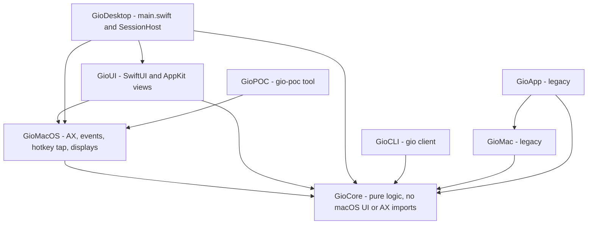
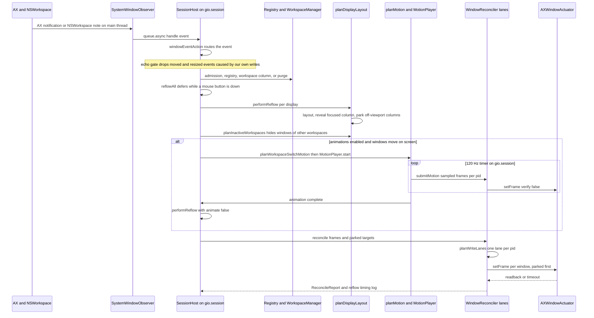
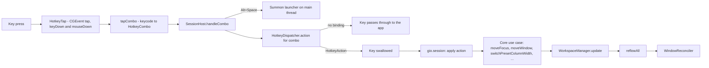
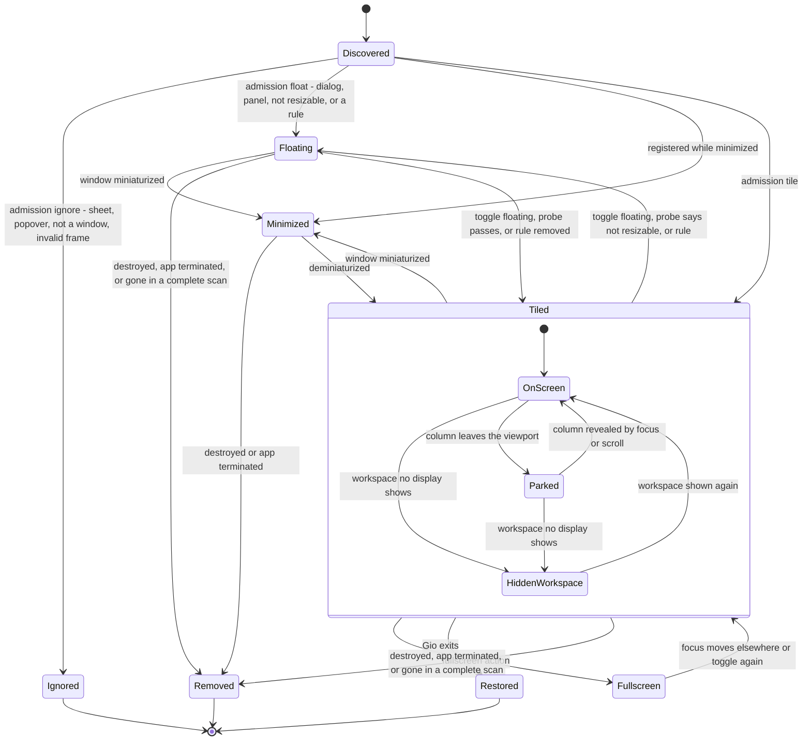
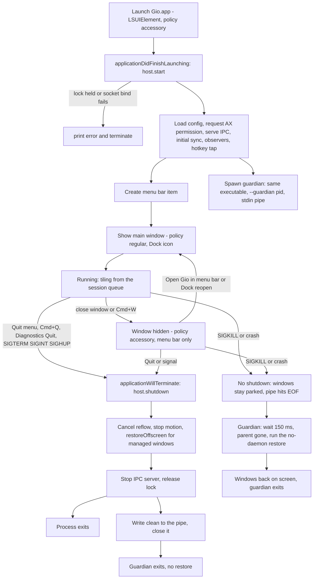

# Architecture

This document explains how Gio is put together, which rules keep it correct, and how a macOS event becomes a window movement. Every claim was checked against the code at the time of writing; where behavior is legacy, unfinished or unverified live, the text says so.

Contents: [Modules](#modules-and-dependency-rules) · [Invariants](#core-invariants) · [State model](#state-model) · [Event pipeline](#event-pipeline) · [Layout details](#layout-details) · [Hotkeys](#hotkey-flow) · [Window lifecycle](#window-lifecycle) · [App lifecycle](#app-lifecycle) · [Coordinate spaces](#coordinate-spaces) · [Concurrency](#concurrency-model)

## Modules and dependency rules

| Target | Kind | Depends on | Role |
| --- | --- | --- | --- |
| `GioCore` | library | none | All decisions: window registry, workspaces, layout, viewport, focus, move/resize, parking, motion planning, reconciler, hotkeys, config, rules, IPC, logging, recovery. Imports only `Foundation`, `CoreGraphics`, `Dispatch`, `Darwin`. |
| `GioMacOS` | library | `GioCore` | macOS adapters: Accessibility discovery and events, `AXWindowActuator`, the `CGEvent` hotkey tap, display snapshots, restore/tile assemblies. |
| `GioUI` | library | `GioCore`, `GioMacOS` | SwiftUI/AppKit: main window, menu bar, launcher, settings views and their view models. |
| `GioDesktop` | executable | `GioCore`, `GioMacOS`, `GioUI` | `main.swift` (app delegate, lifecycle) and `SessionHost.swift` (the live session). Built by the Xcode `Gio` target as `Gio.app`. |
| `GioCLI` | executable | `GioCore` | The `gio` client. The SwiftPM executable is named **`GioCLI`**; its usage text prints `gio`. |
| `GioPOC` | executable | `GioMacOS` | `gio-poc`: Accessibility proof of concept, one-shot tile, and `restore` recovery. |
| `GioMac`, `GioApp` | library, executable | `GioCore` (+ `GioMac`) | **Legacy** prototype from before the rewrite. Not part of the running app. |



**Dependency rules**

1. Arrows point toward `GioCore`. `GioCore` never imports `AppKit`, `ApplicationServices`, SwiftUI or any macOS UI/AX framework. The compiler enforces this because the target declares no dependencies; keep it that way.
2. Decisions live in `GioCore` as pure functions or small value types with XCTest coverage. Adapters (`GioMacOS`, `GioUI`, `GioDesktop`) translate between the OS and Core types and contain as little logic as possible.
3. `GioCore` reaches the OS only through protocols it owns (for example `WindowActuator`, `MotionFrameSink`) that adapters implement.
4. `GioUI` may import `GioMacOS` (for the Accessibility permission request) but must not touch session state directly; it receives `SessionSnapshot` values and calls `DesktopActions` closures.
5. New UI code goes in `GioUI`, not `GioDesktop` (see [CONTRIBUTING](CONTRIBUTING.md#add-a-desktop-app-section)).

## Core invariants

These are hard rules. Break one and the design stops working.

| # | Invariant | Why it exists |
| --- | --- | --- |
| 1 | **State is the source of truth.** The registry, `WorkspaceManager` and `DisplayManager` hold the logical world. Windows on screen are a projection of it. | Prevents reading positions back from apps and fighting them. |
| 2 | **`LayoutEngine` knows no macOS.** `ScrollableLayoutEngine.calculate(workspace:viewport:)` maps a `Workspace` and a viewport rect to absolute frames. No AX types, no clocks. | Makes layout deterministic and testable. |
| 3 | **Only `WindowReconciler` writes window frames.** Flow is always State, then Layout, then Reconciler, then macOS; never hotkey to AX. The reconciler diffs desired against actual and writes only deltas. | One place to enforce tolerances, lanes, timeouts and parking. |
| 4 | **Logic changes go through Core use cases.** Hotkeys and IPC verbs map to actions; actions are pure functions on `Workspace` or the registry. | Keeps behavior testable without a display. |
| 5 | **Gio never manages or actuates its own process.** | See below. |
| 6 | **Logs never contain window titles.** Log lines carry numeric IDs (`pid:elementID`), counts, timings and app names. | Privacy. Titles are kept in memory only and shown in the app, not logged. |
| 7 | **An invalid config never breaks the window manager.** Errors fall back to defaults; unknown keys and tables only warn. | The WM must keep running. |
| 8 | **Absence is not death.** A window or app is removed only on proof: a destroyed event, a terminated pid, or a vanished window in a *complete* scan of that pid. | Enumeration gaps must never wipe state. |
| 9 | **Physical writes never mutate logical state.** Animation only changes what the reconciler writes; workspace state already holds the final layout. | Animation can be cancelled or retargeted without corrupting state. |

Invariant 3 has no exceptions. Every write, including the off-screen prepositioning of incoming windows before a workspace-switch animation (`preposition`), animation frames, and restore, goes through `WindowReconciler` (`preposition`, `submitMotion`, `reconcile`, `restoreOffscreen`). Do not add direct writes.

### Why Gio never touches its own windows (commit `bac43c6`)

Once the main window made Gio a regular app, clicking it made Gio the frontmost application. Focus adoption then registered Gio's own window, and the motion lanes wrote its position through Accessibility from a background thread. AX calls on in-process elements execute AppKit code on the calling thread, which crashed inside `NSWMWindowCoordinator`. The fix refuses Gio's own pid in three places:

- `SessionHost.requestFocusAdoption` returns early for `ProcessInfo.processInfo.processIdentifier`.
- `isManageableProcess(pid:ownPID:onlyPID:)` in `GioMacOS` filters discovery (`discoverSystemWindows`, `discoverSystemWindow`).
- `AXWindowActuator.register` ignores handles for the own pid, so no lane can ever write them.

Any new code path that enumerates windows or adopts focus must go through these guards.

## State model

| Type | Meaning |
| --- | --- |
| `WindowID` | `pid` + `elementID`. `elementID` is assigned by the session (no stable public window number exists); identity across rescans is a retained AX handle matched with `CFEqual`. |
| `ManagedWindow` | Registry record: app name, title, last logical frame, `WindowMode` (`tiled`, `floating`, `fullscreen`), optional `FloatReason`, `isMinimized`. |
| `WindowRegistry` | Single owner of window membership (managed vs ignored). |
| `Column` | Ordered vertical stack of `WindowID`s, a `ColumnWidthSpec` (`standard`, `proportion`, `points`), optional saved width (maximize toggle) and per-window height weights. |
| `Workspace` | Horizontal strip of columns, `focusedColumn`, `focusedWindow`, `viewportOffset`. |
| `WorkspaceManager` | NF-02 dynamic vertical workspaces: an ordered stack per display, stable `WorkspaceID`s, 1-based indices that shift. Invariants after every operation: exactly one trailing empty workspace per stack, empty workspaces the display is not on are removed, the active one may be empty only until you leave it, and windows are never lost (a removed display merges its windows into a survivor). `current` is the focused display's active workspace; `stackSummaries()` feeds status, the menu bar and the Overview. |
| `DisplayManager` / `DisplayState` | Per display: frame, which workspace it shows (mirrored from `WorkspaceManager.activeID(on:)` on every reflow), viewport. The manager owns the stacks; `syncDisplays` registers displays and merges the windows of a vanished one into a surviving stack. |

## Event pipeline

The session runs on one serial queue, `gio.session`, owned by `SessionHost`. Every mutation and every reflow happens there. A macOS event travels like this:



Stage by stage:

1. **Intake (`GioMacOS/Accessibility/WindowEvents.swift`).** `SystemWindowObserver` keeps one `AXObserver` per app (window created, focused window changed, moved, resized, miniaturized, deminiaturized, title changed, element destroyed) plus `NSWorkspace` launch, terminate and activate notifications. Events arrive on the main run loop and are forwarded to `queue.async`.
2. **Routing (`GioCore/Window/WindowEventPolicy.swift`).** `windowEventAction(for:isKnownWindow:)` is a pure table: register, remove, frameChanged, reflow, minimize, restore, updateTitle, adoptFocus, resync, ignore.
3. **Admission and registration (`registerNew`, `classifyWindowAdmission`).** Each new window is classified as `tile`, `float(reason)`, `ignore(reason)` or `suspend(reason)`. Config rules (`evaluateRules`, first match by exact app name wins) can override mode and workspace at arrival. The window gets a fresh column on the target workspace and a per-window observer. Attributes of a brand-new window are often unreadable, so registration retries after 0.1, 0.3 and 0.8 s (`WindowRegistrationRetry`). Observer attachment to a launched app retries after 0.25, 0.5, 1 and 2 s (`ObservationRetry`).
4. **Debounce.** Events that need a rescan call `scheduleReflow`, debounced by 0.3 s (`full: true` re-enumerates; `full: false` only re-lays out). Registration, removal, minimize and restore reflow immediately.
5. **Mouse guard (`ReflowDeferral`).** While a mouse button is down, `reflowAll` polls every 50 ms and coalesces requests, then reflows once after release. Nothing moves under the cursor.
6. **Layout planning (`planDisplayLayout`).** Per display: lay out the strip, compute the minimal scroll that reveals the focused column, lay out again from that offset, then split frames into visible and parked. In real fullscreen the covering window gets the display frame and everything else parks where its column already is. `planInactiveWorkspaces` computes hidden positions for windows of workspaces no display shows.
7. **Motion.** If animation is active, `planWorkspaceSwitchMotion` (which wraps `planMotion`) picks the windows that are on screen at the start or the end and builds `WindowAnimation`s; `MotionPlayer` is driven by a timer on the session queue paced to the display (60 Hz = 16.7 ms, 120 Hz = 8.3 ms; see [Motion](#motion-and-retargeting)). See [Motion](#motion-and-retargeting).
8. **Reconcile (`WindowReconciler.reconcile`).** Windows are grouped by pid into lanes; each lane runs on its own thread. See [Write lanes](#write-lanes-and-timeouts).
9. **Actuation (`AXWindowActuator`).** Converts Cocoa frames to AX, orders position and size writes, verifies visible writes with a readback, and enforces a per-element messaging timeout.
10. **Echo suppression.** Applied frames are recorded in `WriteEchoGate`; see [Echo gate](#echo-gate).

IPC (`gio` CLI) enters the same queue: `IPCServer` calls `queue.sync { handleIPC }`, and verbs that change state (`focus`, `move`, `workspace`, `reload`) end in `reflowAll`.

## Layout details

### Niri proportion width

A column of proportion `p` takes that share of the strip after padding:

```
width = p * (viewportWidth - 2 * padding + gap) - gap
```

So `1/p` such columns plus their gaps fill the viewport exactly. Example: viewport 1800, padding 8, gap 8, `p = 0.5` gives `0.5 * 1792 - 8 = 888`; two columns take `888 * 2 + 8 + 16 = 1800`. Widths are floored at `minimumColumnWidth` (200). `default-column-width` values up to 1 are proportions, larger values are points (`GioCore/Resize/ColumnWidth.swift`, `GioCore/Layout/LayoutEngine.swift`). The same function is used by the engine and by the width actions so what you see is what actions compare against.

### Learned minimum sizes

Apps clamp to an unpublished minimum size (asked 440 wide, got 500) and Accessibility exposes no minimum attribute. When a visible write lands with `frameMismatch` and a dimension came out larger than requested by more than 1 pt, and that growth is anchored to one edge (`learnedMinimum`), `MinimumSizeBook` records the window's minimum (maximum of everything learned). If both edges moved it was position clamping and nothing is learned. The book lives in `SessionHost`, is forgotten on purge and registration, and feeds `ScrollableLayoutEngine.minimumSizes`:

- a column is at least as wide as its widest member's learned minimum (capped to the usable viewport), so neighbours move instead of being overlapped;
- stacked heights come from `distributeHeights`: weights as before, but windows below their minimum are pinned to it and the rest re-share what is left; when the minimums cannot all fit, the plain proportional split is used;
- fullscreen windows are outside the strip and unaffected.

The first pass may fail once (`min size learned` is logged and one relayout is scheduled); the next pass lays the window out at its real size, so the write counts as already correct and `failed` returns to 0. Learning only ever raises a minimum, which bounds retries.

### Reveal and scroll

The focused column is always revealed by the smallest possible scroll (`revealOffset` with `Viewport.ensureVisible`). A column wider than the viewport pins to its start. Offsets are clamped to `[0, contentWidth - viewportWidth]`. Center-column (`Alt+C`) sets the offset so the focused column is centered, clamped at the strip edges.

### Parking

macOS refuses to place a window fully off-screen, so a window that is not visible keeps a sliver inside the display (`parkingSliver = 1` point). All parking is computed against the **full display frame**, not the usable area, so a Dock inset never leaves a parked window visible.

| Situation | Where the window goes |
| --- | --- |
| Column left of the viewport | x = `display.minX - width + 1`, keeps its y and size (left edge). |
| Column right of the viewport | x = `display.maxX - 1` (right edge). |
| The preferred edge would overlap another display | The other edge is tried. |
| Both edges touch another display | Bottom-right corner: x = `display.maxX - 1`, y = `display.minY - height + 1`. |
| Window of an inactive **workspace** | Always below the display: bottom-right corner, bottom-left if a neighbour overlaps it, size kept. Floating windows remember their frame (`HiddenWindowBook`) and return to it when their workspace is shown. |

Reconciler behavior for parked targets: written before visible windows in the same lane, never verified by readback, never focused. A landing counts as parked (`already correct`) if the size is unchanged and no more than `parkedStripLimit` (40 pt) of the window remains inside the display on the intended side, because macOS may clamp the requested position (`isParked`). A `parked clamped` debug line records this.

### Write lanes and timeouts

`planWriteLanes` builds one lane per pid. Inside a lane the order is fixed: parked targets first, then visible frames, each sorted by `WindowID`. Lanes run concurrently (`LaneConcurrency.concurrent(stallTimeout: 0.25)`).

- A lane that makes no progress for **0.25 s** is abandoned: its unfinished windows are reported as `failed` with `timeout` and the reflow returns without waiting.
- The abandoned pid stays marked busy until its thread comes back. Further writes to that pid are skipped with `timeout (previous write to this app still pending)`, so a hung app is never written by two overlapping lanes.
- `AXWindowActuator.messagingTimeoutSeconds = 0.25` is applied to each AX element (the system default is about 6 s). The same timeout affects discovery reads on slow apps.
- Per window the reconciler reads the actual frame, skips the write if it is within `tolerance` (1 pt) of the target or already parked, and otherwise calls `setFrame(_:from:for:verify:)` with the frame it already read (no second read).
- Write order in the actuator: position first when the target grows in either dimension, size first when shrinking, to avoid macOS clamping a large frame written from a small position.
- Every failed window is logged by `WindowReconciler` as `reconcile failure id= app= kind= requested= actual=` (FI-01). `ReconcileReport.failures` carries the same data structured (`ReconcileFailure`). Adapter errors report their kind through `FrameFailureReporting`, so `GioCore` stays free of adapter types. `FailureLogGate` warns once per (window, kind) and logs repeats at debug.
- Focus, when requested, is applied last, after every lane. `SessionHost.performReflow` passes a focus target only when a keyboard or IPC action left a `FocusIntent` (focus, move, workspace, consume/expel, fullscreen). The target is focused and raised after its frame is written; during an animation it is held until the final exact pass. Passive reflows (AX events, click adoption, reload, rescans) pass `nil` and never steal focus. `FocusIntent` also ignores trailing activation events that contradict a fresh intent, and a mouse click cancels it.

### Motion lanes

PA-05. Animation frames do not go through the reflow lanes. `WindowReconciler` owns one **persistent serial lane per pid** (`MotionLane`, a serial `DispatchQueue` created on the first frame for that app and reused across frames and reflows). Each lane has a single **pending-frame slot** (`MotionSlot`):

- `submitMotion` stores the newest target for the app and schedules the lane only if it is idle. No worker, group or per-frame closure is allocated; the lane's drain block is built once.
- If the lane is still busy, a not-yet-started frame is **overwritten** (latest wins). The overwritten frame counts as a drop (`MotionWriteStats.drops`, added to `dropped` in `anim done`). Overwriting merges per window and keeps the oldest `from`, so an attribute change of a dropped frame (the first-frame shrink of FI-03) is never lost.
- The lane claims the pid in `LaneExecutor` while it runs, so a reconcile lane and a motion lane never write the same app at once. `submitMotion` returns false only when an abandoned reconcile lane still holds the app.
- Completion is a counter and a condition, not a `DispatchGroup` per frame. `waitForMotionIdle` (used by the final exact pass and by `MotionPlayer.finish`) waits, bounded, for the in-flight writes; on timeout the frames still pending are discarded so a stuck app never receives stale frames after the final pass, which then reports `timeout (previous write to this app still pending)` as before.
- A lane is torn down by `forgetApp(pid:)` (called from `handleTerminated`): it is removed from the registry, an in-flight write finishes, and a later frame for a reused pid gets a fresh lane.

### Motion and retargeting

- `planMotion` animates a window only if its start frame **or** its target frame is on screen (more than two parking slivers inside the viewport). Typically 2 to 4 windows; parked-to-parked moves jump in the final pass.
- Start frames come from `physicalFrames`, the last frame Gio applied or sampled. A window with no known frame is read once (`learnPhysicalFrames`) so new windows can slide in.
- `MotionPlayer.start` on a run in flight **retargets**: new animations replace the old ones starting from the sampled frames and the clock restarts, while the run's counters continue, so nothing snaps back.
- **Position only (FI-03).** The player writes `WindowAnimation.motionFrame(at:)`, not the full interpolation: the origin follows the easing, the size never interpolates. A dimension that shrinks takes its new value from the first frame, so the window leaves its neighbours' way before anything moves. A dimension that grows keeps its old value for the whole flight, including the last tick, and the final exact pass applies it once the neighbours have moved. Mixed changes (one grows, one shrinks) split accordingly. Every frame after the first is therefore position-only: one Accessibility write per window per frame instead of two. Workspace-switch flights already keep a constant size (`slideDownFrame`). `preposition` still writes the full target frame, because the window is entirely below the display at that moment and cannot overlap anything.
- **Renderer choice (SM-01).** `[animations] renderer = "snapshot" | "ax"` (default snapshot). `effectiveRenderer(config:permission:)` (`Animation/RendererChoice.swift`, pure) yields `.snapshot` only when configured and `CGPreflightScreenCaptureAccess()` is true, else `.ax`; `RendererLogGate` logs `renderer effective=... reason=...` once per change from `sessionFacts()`. The permission is published in `SessionFacts.screenRecordingGranted` and shown in Overview and Diagnostics; the request (`CGRequestScreenCaptureAccess`, `GioMacOS/Accessibility/ScreenRecordingPermission.swift`) runs on main and only from the "Request access" buttons, never at launch.
- **Snapshot capture (SM-02).** `GioMacOS/Snapshot/SnapshotCapturer.swift` captures managed windows (`SCScreenshotManager.captureImage` with `SCContentFilter(desktopIndependentWindow:)`, size = points x backing scale, no cursor, no shadow) and one backdrop per touched display (`SCContentFilter(display:excludingWindows:)` leaving out the animated windows and every Gio-owned window) concurrently, under an overall budget (`SnapshotBudget.defaultMilliseconds` = 45); unfinished work is reported as misses and dropped. `SCWindow.frame` is global, top-left origin (like CoreGraphics bounds), so windows are matched against `CGWindowListCopyWindowInfo` bounds flipped to Cocoa (`windowServerSnapshotCandidates`) using the FI-05 rule (exact frame per pid, then unique same size, ambiguous skipped; `matchSnapshotCandidates`, pure) and joined to ScreenCaptureKit by `CGWindowID`, so the cached, stale `SCWindow` frames are never compared. `SCShareableContent` is cached and refreshed only when the managed set changes or a wanted window is missing. `SCScreenshotManager` needs macOS 14 (package target is 13): older systems report every window as a `failed` miss. Images are never cached; the result owns them. Logs: debug `snapshot window id=pid:element ms=`, info `snapshot capture windows=N captured=M backdrop=<bool> ms=T misses=K`. The motion uses it through the pre-captured cache (see [Snapshot pipeline](#snapshot-pipeline-sm-03sm-05)); Diagnostics also has a "Test snapshot capture" debug button (off the hot path). After SM-02c the matching has a third pass: with no exact and no same-size candidate, the unique unclaimed same-pid candidate overlapping at least 80% of the larger frame's area matches (an app that learned a larger minimum size, e.g. AX 888 wide vs 900 drawn); several such candidates stay ambiguous.
- **Adaptive size (PA-06).** FI-03 is the default (`[animations] resize = "never"` since SM-00, because the adaptive first attempt made the growing app relayout every frame), not the only mode. `WindowAnimation.sizeSchedule` (`none`, `fromStart`, `from(t0)`) lets a growing dimension interpolate during flight; shrinks still land on the first frame. `planSizeSchedules` (`Animation/SizePlanner.swift`, pure) grants a schedule only when (a) the app passes `ResizeCapability` (or `[animations] resize = "always"`) and (b) sampling 5%..95% of the flight shows no overlap (more than 1 pt on both axes) with any other animation's own `motionFrame`; if a neighbour is in the way early, the grow is delayed to the first 5% step at which it clears and still lands exactly at t = 1. Windows are decided in id order against already-decided schedules; non-animating windows are not obstacles (the layout never overlaps them). Size progress is the origin's normalized progress (easing fraction, or for springs `1 - x(t)/x(0)` on the dominant axis, clamped), so size and position arrive together; without origin travel it is ease-out over the duration. `ResizeCapability` (keyed by app name) keeps an EWMA (alpha 0.4) of per-frame write cost and drop rate from `MotionSummary.appStats`, fed after each `anim done`; an app qualifies with cost at most 4 ms, drops at most 10% and 2+ usable motions (3+ writes each), so unknown apps stay on FI-03 until learned. A learned minimum size (frame mismatch, FI-02) blocks it for 5 motions. The lanes are unchanged: a dropped size frame is merged into the newest one and the final exact pass still sets the exact size. `anim done` gains `sizeAnimated=N`; capability changes log at debug.
- **Frame pacing (PA-03).** The timer interval comes from the display that holds the moving windows: `motionRefreshRate` picks the fastest `NSScreen.maximumFramesPerSecond` among the displays containing any animation's start or end frame (60 when unknown), and `frameInterval(for:)` clamps it to 30...120 Hz. The refresh rates are read on the main thread (`snapshotDisplayRefreshes`, at start and on every screen-parameter change) and published to the session behind a lock; the session queue never queries AppKit for them. The interval is fixed when a motion starts.
- **Per-frame cost (PA-03).** Sampled origins are rounded to whole points (sizes stay exact; whole points chosen over the 0.5 pt backing grid because sub-point steps are invisible and the AX writer ignores them). The player's "differs" test uses the writer's tolerance (`frameWriteTolerance`, 1 pt), so a delta the writer would skip is never submitted. Motion write timings are aggregated in place per pid (`MotionWriteStats`: count, sum, max, drops), app names are resolved once per pid by `AppNameCache` (only for the slowest app when the run finishes, and once per pid when a reflow report is folded), and `AXWindowActuator` counts AX calls only while the log level is debug (`countsCalls`).
- Each timer tick samples every animation by elapsed time (late ticks stay honest) and hands the changed frames to `submitMotion`, one submission per pid. `submitMotion` never blocks (see [Motion lanes](#motion-lanes)).
- When the last animation completes, `performReflow(animate: false)` runs the exact final reconcile with verification.
- If a mouse button goes down mid-flight the animation is abandoned, `skipAnimationOnce` is set and the deferred reflow finishes instantly after release.
- Curve (NF-04): by default every flight is a Niri-style spring (`Animation/Spring.swift`, mass 1, damping ratio 1.0, stiffness 800, solved analytically for under, critically and over damped cases). `WindowAnimation.duration` is the time the spring needs to settle (displacement and velocity under `max(epsilon * travel, 0.5 pt)`, hard cap 1 s), and the final sample is pinned to the target. `MotionPlayer.start` on a run in flight hands each spring the origin velocity its predecessor had at the last sampled tick, so a retarget is continuous in position and velocity. `[animations] curve = "ease-out"` restores the old easings: `easeOut` for scroll and focus moves, `easeInOut` for workspace slides, default duration 200 ms.
- Keyboard bursts (FI-06): while a motion is in flight `ReflowCoalescer` defers the retargeting reflow to the next timer tick, so N rapid actions cost one reflow per tick. Focus for keyboard/IPC actions is applied right after the motion starts (`FocusIntent.takeImmediate` and `WindowReconciler.focusNow`); the final exact pass re-asserts it only if focus drifted (`takeReassert`): another app frontmost, or the frontmost app's `AXFocusedWindow` resolves to a different window or cannot be read (once per intent).
- Workspace switches move vertically through the bottom edge (macOS cannot place windows above the menu bar): outgoing windows drop below the display, incoming hidden windows rise from directly below their target after an invisible pre-position write.

### Trusted frames and the lean settle (PA-04)

The final exact pass used to read AX frames (two calls) for every window, parked ones Gio itself placed included. `TrustedFrames` (`GioCore/Reconciliation/TrustedFrames.swift`) remembers the frame Gio wrote and verified, or found correct, for each window. `WindowReconciler.reconcile(..., trusted:)` skips the read and the write of a window whose desired frame equals its trusted frame within 1 pt (parked to parked, hidden, and unchanged visible windows) and counts it `already`; `ReconcileReport.skippedReads` and the debug lines `reconcile ... skippedReads=N` / `settle skippedReads=N` report how many. Trust is recorded after each settle (`recordSettle`: applied, parked and already-correct windows are trusted at their desired frame) and dropped by:

- a non-echo moved/resized event for the window (user drag, app-initiated resize), minimize/restore, purge and re-registration;
- a failed, vanished or timed-out report (so learned minimum sizes and failure reporting are unchanged: a clamped visible write fails, is not trusted, and is read again);
- the start of a motion or a pre-position that moves it (motion frames are unverified, so animated windows are still read in the final pass);
- any display topology change (all trust cleared; macOS may relocate windows and every parking target changes).

Known limit: a window moved by something that raises no AX event, or moved by the user inside the 0.35 s echo suppression window, stays trusted until the next event or motion for it.

Per-tick bookkeeping is in place: a motion tick updates `physicalFrames` and the echo gate only for the windows sampled that tick (no dictionary merges), and publishes the focus ring only when the focused window was sampled. `FocusRingPublishGate` further drops a publication unless visibility, style or the frame (by at least 1 pt on any edge, measured against the last published frame) changed. While a motion runs, moved/resized events from pids that are being animated are our own writes and are dropped first thing (`dropsAsMotionEcho`), before the handle lookup and the echo gate.

Retained AX handles are indexed by `CFHash(element)` (`HandleIndex`): `AXWindowActuator.id(matching:pid:)` looks up the bucket and verifies with `CFEqual` and the pid inside it, instead of scanning every handle under the lock. The hidden-window parking plan (`planInactiveWorkspaces`) is memoized (`PlanMemo`) on its inputs (hidden frames, display frames); a change of membership, frames or displays recomputes it, and config reload and display changes invalidate it explicitly.

### Echo gate

Gio's own writes raise moved and resized events. `WriteEchoGate` records every applied frame with the system uptime. An event for that window is ignored if it arrives within **0.35 s** of the write (the AX read is skipped entirely) or if the window's observed frame is within **2 pt** of the last applied frame. Without this, write, event, reflow, write would loop.


### Snapshot pipeline (SM-03..SM-05)

With the snapshot renderer the real windows move once and a Core Animation overlay draws the motion:

```
settle (any reflow that ends still)            keypress -> performReflow (animating)
        |                                              |
        v  300 ms debounce, one-shot                   v  driveSnapshotFlight (session queue)
scheduleSnapshotRefresh                         planSnapshotFlight  --missing image / backdrop--> AX motion
        |                                              |            (log: snapshot fallback reason=... ids=N,
        v  SnapshotCapturer (no backdrop,              |             next refresh scheduled)
SnapshotCache<CGImage>  <- images                      v  overlayBegin (hop to main)
  visible + adjacent columns                    SnapshotOverlay: opaque panel + wallpaper + one CALayer per window,
  + focused window of adjacent workspaces         CASpringAnimation on position and bounds (render server; no per-frame work)
  LRU, cap 12 display-fulls of pixels                   |                     |
                                                       |  instant pass: ONE write of each real window (reconciler)
                                                       v                     v
                                                layers landed (CA completion) AND final pass settled  (SnapshotFlightGate)
                                                       |
                                                       v  overlayEnd(fade 60 ms) -> ring, render check, cache refresh
```

- **Cache (`SnapshotCache`, pure).** Keyed by `WindowID` with frame, capture time, last use and pixel count; images are `CGImage` held by the session. After each settle one background capture (`snapshotRefreshSet`) covers the visible columns, the column just left and right of them and the focused window of the workspaces above and below (at most 12 windows). No periodic timer: a burst of settles is debounced to one capture, and a capture that finds another running asks for one more run. Eviction: windows that closed or minimized (`retain`), then least recently used until the total is within `snapshotCacheCapPixels` (12 x the largest display in pixels). An entry is usable only if it is at most 60 s old and its size still matches the window (`snapshotEntryUsable`); otherwise it is a miss.
- **Renderer per motion (`planSnapshotFlight`, pure).** Snapshot only when configured, permitted (checked at every motion, so a revoked permission flips to AX and clears the cache) and macOS 14+. Because the overlay is opaque, every window visible at the start or end of the motion on an involved display needs a layer, moving or not; a parked window's 1 pt sliver does not count. If any of them has no usable image, or a display has no wallpaper yet, the whole motion uses the AX renderer and `snapshot fallback reason=cache-miss|no-backdrop|nothing-visible ids=N` is logged; the capture is scheduled so the next motion is covered.
- **Real windows.** The ordinary instant reflow pass runs right after the overlay starts: one reconciler write per window to its final frame (normal lanes, echo gate, trusted frames), hidden under the overlay. Focus intent is applied in that same pass, i.e. at motion start (HD-01/FI-06). Resizes scale the layer's bounds; the real window is resized once.
- **Retarget.** A reflow during a flight (coalesced to about 30 ms) retargets the layers: each `CASpringAnimation` restarts from the layer's presentation value (`retargetStart`); initial velocity is not carried over (the spring restarts from rest). Windows that become involved and have an image get a new layer; windows without one are written once under the overlay and revealed when it ends (no AX motion mixes into a flight).
- **Overlay (`GioUI/SnapshotOverlay.swift`, main thread).** One borderless, click-through, non-activating `NSPanel` per display at level `.normal + 1` (app windows 0, overlay 1, focus ring `.floating` 3, Dock 20, menus 24), collection behavior `canJoinAllSpaces, stationary, ignoresCycle, fullScreenAuxiliary`. The backdrop is the display's desktop wallpaper (`NSWorkspace.desktopImageURL`, downsampled with ImageIO off the main thread, aspect-fill, reloaded on screen, Space and wallpaper changes). Layers use `contentsGravity = .resize`, a 10 pt corner radius and no shadow. Spring mapping (`overlaySpring`): mass 1, stiffness k, damping `2 zeta sqrt(k)`, the same equation as `SpringParameters`.
- **Focus ring.** Hidden while a flight is in the air (the real window is already at its final frame, the image is not) and shown again at the settle, so it never sits apart from its window.
- **Safety.** A watchdog owned by the overlay controller (`FlightWatchdog`, 1.5 s from the latest begin or retarget, armed on the main thread, independent of the session queue) removes the overlay and reports `snapshot flight aborted reason=watchdog` (warn). A mouse button going down (`recordClick`, main) removes it at once (`reason=mouse-down`); a screen-parameter change ends it (`reason=display-change`). Quit, restart and shutdown call `SnapshotOverlayController.stop()`; a crash takes the overlay with the process (the guardian only ever restores real windows, which were already at their final frames).
- **Logs.** `anim done ... renderer=snapshot|ax`, `snapshot flight layers=N cacheAgeMs=M duration=Xms`, `snapshot fallback ...`, debug `snapshot cache entries=N pixels=P evicted=E`.
- **Accepted tradeoff.** During the ~350 ms flight the image shows the window as of the last settle, and windows Gio does not manage (or manages as floating) are hidden by the opaque overlay until it ends.

### Render verification (FI-05)

Accessibility can report a window at its target while the WindowServer still draws it elsewhere (seen with Chromium/Electron windows coming back from parking). About 150 ms after a settle that wrote or animated visible windows (a motion's final exact pass, or an instant reflow with visible `applied` windows), `SessionHost.runRenderCheck` runs on the session queue. Scope (PA-04): only visible targets that were written or animated since the last check (`renderCheckFrames`); a settle that only wrote parked or hidden windows skips the check, including the WindowServer snapshot. Steps:

1. Take the AX frames the settle already read or verified (`ReconcileReport.settledFrames`; no new AX read) and the WindowServer list through `windowServerWindows` (`CGWindowListCopyWindowInfo` with `.optionOnScreenOnly`: pid, layer 0, bounds only; no titles, no Screen Recording). Bounds are converted to Cocoa with `cocoaFrame(fromWindowServer:)`.
2. `matchServerWindows` maps windows to entries by pid: an entry equal to the AX frame wins; otherwise the unclaimed same-size entry; several same-size entries with no exact one are ambiguous and skipped (never guessed).
3. `findRenderMismatches` keeps windows whose target intersects a viewport and whose WindowServer bounds differ from the AX frame by more than 2 pt in position or size. Logged as `render mismatch` (warn once per window, then debug).
4. Nudge, through `WindowReconciler.nudge`: write the target shifted 1 pt on x (inward at the right viewport edge), then the target. A plain rewrite of an unchanged frame is skipped by AX, so the offset step is the minimal sequence that makes the app commit a new position twice. Writes are recorded in `WriteEchoGate`. After 100 ms the window is re-checked once, again against a fresh on-screen snapshot and without an AX read, and `render nudge ... fixed=` is logged.

SM-02c: `.optionOnScreenOnly` only lists windows that are on screen, so a visible target with no entry of its pid at all (nothing exact, same-size or 80%-overlapping) is a mismatch with `ws=missing` (`RenderMismatch.ws == nil`) and gets the nudge and the one re-check like any other; only ambiguous windows are skipped. A match whose size differs (`matchServerWindows` pass 3, minimum-size learning) is not a mismatch. While an overlay flight is up the check waits and is rescheduled at the settle, so it verifies the real windows after the overlay is gone.

Bounds (`RenderCheckBook`): at most one nudge per window per settle, never a loop; any new reflow or motion cancels a pending check; the check also skips while a motion is in flight or a mouse button is down. It never blocks main or hotkeys.

### Focus settle

Clicking a window makes the activation event and the focused-window event outrun the app's own `AXFocusedWindow`. `FocusSettle` (pure state machine in `GioCore/Focus/FocusSettle.swift`) handles it:

1. Keyboard-driven focus events (no click in the last 0.3 s) are adopted immediately.
2. Mouse-driven ones are coalesced (last event wins), wait for the button to be released plus an 80 ms settle delay (polling every 20 ms), then the focused window is read.
3. The window must contain the click point (2 pt slack). On mismatch it is re-read once after 100 ms; a second mismatch drops the adoption and logs `focus dropped`.
4. Clicks outside every display's usable area (menu bar, Dock) are not window clicks. Focus events from a non-frontmost app and from Gio itself are ignored.
5. After adoption a reflow happens only if the viewport has to scroll to show the focused column (`pendingScroll`).

Frontmost-app rule: a full rescan adopts the focused window of the **frontmost** app only; adopting "the last app that reported a focused window" scrolled the strip to an arbitrary column (fix `4a6351b`).

## Hotkey flow



Notes:

- The tap is a `cgSessionEventTap` inserted at the head, running on the main run loop. It observes mouse-downs (never swallowed) and swallows only key-downs that exactly match a bound combo, so ordinary typing is unaffected.
- Key names live in one shared vocabulary, `supportedKeyNames` (`GioCore/Hotkeys/KeyNames.swift`): A-Z, 0-9, F1-F12, arrows, Tab/Return/Escape/Space/Delete, Home/End/PageUp/PageDown and punctuation. `parseHotkey` accepts only these (plus aliases); `tapKeyCodes` in `GioMacOS/Hotkeys/HotkeyTap.swift` maps each name to its ANSI keycode, and a test keeps both identical. A config binding on any other key is a validation error.
- `Alt+Space` is intercepted in `handleCombo` before the dispatcher and is not configurable.
- The dispatcher is rebuilt from `config.makeDispatcher()` at start and on every reload (`refreshDispatcher`). Config bindings are additive: they bind or override combos on top of the defaults, and there is no unbind syntax.
- If the tap cannot start (no Accessibility permission), Gio keeps running without global hotkeys and retries on the next resync.

## Window lifecycle



Details that the diagram compresses:

- **Admission** (`classifyWindowAdmission`): role must be `AXWindow`; `AXSheet` and `AXPopover` are ignored; `AXDialog`/`AXSystemDialog` float as `dialog`; `AXFloatingWindow`/`AXSystemFloatingWindow` float as `floatingSubrole`; invalid frames are ignored; native fullscreen and minimized windows are `suspend` candidates; an unknown or empty subrole tiles if position and size are settable (Electron, Java and Qt windows), otherwise floats as `notResizable`.
- **Floating is managed, not omitted.** Floating windows stay registered with a reason (`dialog`, `floatingSubrole`, `notResizable`, `rule`, `manual`), keep their own frame, and are visible in the Overview. Tileability is probed once per window and cached (`TileabilityCache`), invalidated on resize events.
- **Minimized** windows keep their column (position memory) but sit out of the layout; focus is handed to the nearest visible window (same column, then right, then left).
- **Fullscreen** here is Gio's own layout mode, not a native macOS fullscreen Space: the window gets the display width and reaches the bottom edge but stops under the menu bar, all tiled windows park where their columns are, and leaving restores the previous mode and frame.
- **Restored on exit**: `WindowReconciler.restoreOffscreen` (via `planRestore`) writes only windows that are not fully inside a display, cascading from the top-left of the visible frame in 32 pt steps (8 slots), keeping size (shrunk only if larger than the visible frame).
- **Removal**: `AXUIElementDestroyed` removes exactly that window; a terminate notification reaps the pid; a complete scan of a pid that no longer lists a registered window purges it. Partial scans never remove anything.

## App lifecycle



- `main.swift` sets the activation policy to `.accessory` before `run()`; `Info.plist` also sets `LSUIElement`. `desiredActivationPolicy(windowVisible:)` (in `GioUI/MainWindow.swift`) flips it to `.regular` while the main window is visible and back to `.accessory` when it closes.
- The delegate ignores SIGTERM, SIGINT and SIGHUP at the default handler level and routes them through `host.shutdown()` then `terminate`. `shutdown()` is idempotent and synchronous, so the terminate hook can call it again safely.
- **Limitation:** SIGKILL (for example Xcode's Stop), a crash, or a power loss cannot run any handler. The guardian (above) restores them within about a second; if it was not running, parked windows stay at the display edge. Recover with `gio-poc restore` (or the `gio-poc-restore` Xcode scheme) or start Gio again: the initial sync restores leftover off-screen windows that will not be tiled, and the first reflow re-places tiled ones.
- **Guardian (HD-07).** After IPC is serving, `SessionHost.start` calls `spawnGuardian()`, which re-executes the same executable (`Bundle.main.executableURL`) with `--guardian <pid>` and a `Pipe` as the child's stdin. `main.swift` detects the flag before any `NSApplication` setup and calls `runGuardianProcess`: no Dock icon, no menu bar item, no window, no single-instance lock, no IPC. It closes inherited descriptors (so the lock and socket cannot outlive Gio through it). The protocol lives in `GioCore/Commands/Guardian.swift`: `shutdown()` writes `clean\n` and closes the pipe after the restore, so the guardian exits quietly. End-of-stream without `clean` (garbage counts as silence) means Gio died abruptly: after 150 ms the guardian confirms the parent pid is gone (`kill(pid, 0)`), and runs the same restore as `gio-poc restore` (`runRestoreOffscreen`; discovery skips its own pid). If Accessibility is missing it logs and exits. Log lines are `guardian started parent=N`, `guardian clean exit`, `guardian restore applied=N ...`. If the spawn fails Gio logs a warning and runs without it. Assumption to validate live: the child shares the parent's bundle and code signature, so the Accessibility (TCC) grant applies to it; TCC attributes a process to the signed code of its executable, not to who launched it.
- Only one instance runs: `SingleInstanceLock` (`flock` on `~/.config/gio/gio.lock`).

## Coordinate spaces

Gio uses three coordinate conventions and converts at the edges.

| Space | Origin and axes | Where used |
| --- | --- | --- |
| **Cocoa** (`NSScreen`) | Bottom-left of the primary display, y up | Everything in `GioCore`: layout, planners, parking, reconciler, registry frames, restore. |
| **AX** (Accessibility, CG) | Top-left, y down | Only at the adapter boundary: `AXWindowActuator` reads and writes, and the places where `SessionHost` ingests discovered AX frames (`enumerateAndPlace`, `registerNew`). |
| **Content vs screen** (inside the viewport) | Content x is measured from the start of the column strip; screen x is `viewport.minX + contentX - offset` | Layout frames are screen rects, while `viewportOffset` and `Viewport` work in content space. |

- `AXVerticalFlip` converts with `y' = displayHeight - y - height`. It needs the **full** display height, not the visible frame. `SessionHost` uses `NSScreen.main.frame.height` for all displays; the live behavior with several displays of different heights is a recorded gap (single-height flip) and has not been validated live.
- Mixing Cocoa and AX coordinates was the original live failure: windows were placed into the menu bar and macOS clamped `y = 8` to `y = 39` (fix `614ec32`). If a live frame is off by the menu bar height, suspect a missing or double flip.
- **Reveal in content space (fix `592c89d`).** `revealOffset` used to compare screen-space frames with a content-space offset, which produced wrong scrolls (`1824->0`, `1816->916`, `0->16` in the live logs). It now converts with `toContent = layout.viewportOffset - viewport.minX` before calling `ensureVisible`. Any new code that compares a layout frame with `viewportOffset` must convert first.
- Fraction widths ignored padding and gap, so two `0.5` columns overflowed by 16 pt; the fix is `proportionalColumnWidth` (see [Niri proportion width](#niri-proportion-width)).
- Mouse locations from the tap (`NSEvent.mouseLocation`) are Cocoa global coordinates, the same space as window frames, so click-point validation needs no flip.

## Concurrency model

- `SessionHost` is `@unchecked Sendable`; **all session state mutates on the `gio.session` serial queue**. Callers hop on (`async` from UI and tap, `sync` from the IPC thread) and never touch state directly. **Do not nest `queue.sync`**: it deadlocks.
- The hotkey dispatcher table has its own lock because the tap reads it on the main thread.
- **The main thread never waits on the session queue.** A slow reflow (AX timeouts of 250 ms per app) would stall the main run loop, macOS would then disable the event tap by timeout, and every shortcut would be dead for the session. So `SessionHost.snapshot()` returns the last `SessionSnapshot` published (lock-guarded `PublishedValue`) by the session queue and only asks the queue for a fresher one asynchronously; `reloadConfig`, `restoreAllWindows` and `focusWindow` use `queue.async`; `applyConfigEdits` patches the file on the caller and reloads via `queue.async`; the menu bar does its IPC round trip off-main. Only launch and shutdown use `queue.sync` from main.
- **The tap heals itself.** `tapCallback` re-enables the tap on `tapDisabledByTimeout` / `tapDisabledByUserInput` (`hotkey tap re-enabled after ...`), and a 30 s watchdog (10 s leeway, safety net only) on the main queue re-enables a tap that is off without notice. The tap subscribes to `mouseMoved` only while `behavior.focus-follows-mouse` is on; a reload that flips it rebuilds the tap (`hotkey tap restarted`). Decisions live in `GioMacOS/Hotkeys/TapResilience.swift`.
- **The focus ring (NF-01) is a Gio-owned overlay fed by publication, never by a wait.** `SessionHost.publishFocusRing()` runs on the session queue after every reflow, on focus adoption, on config reload and on **every motion tick** (so the ring follows animations). It derives `FocusRingState` (`GioCore/FocusRing`, pure) from the registry, `physicalFrames` and display frames only: no AX call. The state goes into a `LatestValueMailbox`, which keeps the newest value, drops values equal to the last posted one, and asks for at most one pending `DispatchQueue.main.async` drain at a time, so a flood of frames cannot back up the main queue. On main, `GioUI.FocusRingController` owns one borderless, non-activating, click-through `NSPanel` (level `.floating`: above ordinary windows, below menus; joins all Spaces; never key or main) and masks the state while `NSApp.isActive` (Gio's own window or launcher is frontmost). The panel is Gio's own pid, so it can never be registered or actuated (invariant above). Fullscreen windows hide the ring.
- **Idle policy (PA-02): event-driven, no periodic work when idle.** With no input and no window events Gio should sit at ~0% CPU. The only recurring timers are the 30 s tap watchdog and, while the main window is visible with a section on screen, that section's refresh (`pollWhileVisible`, gated by `shouldPoll(windowVisible:sectionOnScreen:)`; `MainWindowController` tells `DesktopModel.windowVisible` on show/hide/occlusion). The menu bar has no timer: `SessionHost.publishBarState()` pushes a deduplicated `BarSessionState` after each reflow and IPC command (`BarStateGate`), the title follows, and menu items are rebuilt from it in `menuNeedsUpdate`. The Logs section reads the file incrementally (`LogTail`, rotation/truncation aware). Log writes are batched on a utility queue (`LogFileSink`) and lines below `[logging] level` cost only a compare. Do not add periodic work without gating it on visibility or an event.
- The click record (`tappedClick`) has its own lock (tap writes on main, session reads).
- `AXWindowActuator` guards handles and the flip with a lock because reflow lanes read them from several threads and an abandoned lane can outlive its reflow.
- AX observers and hotkey tap sources always run on the **main** run loop. Rebuilt observers once landed on the session queue's run loop, which never runs (fixed in `e9c8066`).
- The UI reads state through `SessionSnapshot` values produced on the session queue; `DesktopModel` publishes them on the main actor.

## Where things live

| Concern | Files |
| --- | --- |
| Session wiring | `Sources/GioDesktop/SessionHost.swift`, `Sources/GioDesktop/main.swift` |
| Layout and parking | `Sources/GioCore/Layout/*` |
| Reconciler, lanes, timing | `Sources/GioCore/Reconciliation/*` |
| Motion | `Sources/GioCore/Animation/*` |
| Hotkeys and catalog | `Sources/GioCore/Hotkeys/*`, `Sources/GioMacOS/Hotkeys/HotkeyTap.swift` |
| Config | `Sources/GioCore/Config/*` |
| IPC and CLI grammar | `Sources/GioCore/IPC/*`, `Sources/GioCore/Commands/*` |
| AX adapters | `Sources/GioMacOS/Accessibility/*` |
| Decision history | `odd/tasks/*.md` |
