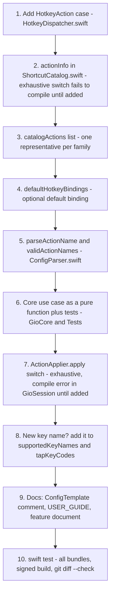

# Contributing

How to change Gio safely. Read [ARCHITECTURE](ARCHITECTURE.md) first (modules, invariants) and [TESTING](TESTING.md) (how to run and verify).

Contents: [Workflow](#workflow) · [Strict TDD](#strict-tdd-expectations) · [Recipe: hotkey action](#add-a-new-hotkey-action) · [Recipe: config key](#add-a-config-key) · [Recipe: desktop section](#add-a-desktop-app-section) · [Recipe: admission rule](#add-a-window-admission-rule) · [Checklist](#before-you-commit)

## Workflow

| Topic | Rule |
| --- | --- |
| Branch | Work on a feature branch (the current rewrite lives on `feat/gio-niri-rewrite`). Branch first if you are on `main`. Do not push, open a PR or merge unless the maintainer asks. |
| Commits | [Conventional Commits](https://www.conventionalcommits.org/): `feat(layout): ...`, `fix(session): ...`, `perf(reconcile): ...`, `docs(odd): ...`, `chore: ...`. Imperative, lowercase subject; a short body explaining the *why* (see `git log` for the style). |
| Trailers | **No `Co-Authored-By` and no AI attribution trailers.** Ever. |
| Granularity | **One work-unit commit per task**: a coherent behavior with its tests and docs together, so it is reviewable and revertable alone. Docs-only progress notes get their own `docs(odd): ...` commit. Aim for roughly 400 authored changed lines per task as a planning heuristic, not a hard cap; do not split artificially or drop tests to fit. |
| Feature documents | Non-trivial work is tracked in `odd/tasks/<feature-name>.md` (see below). |
| Secrets and personal state | Never commit your development team ID changes, `xcuserdata`, `.build/` or DerivedData (`.gitignore` covers the last three). |

### Feature documents (`odd/tasks/`)

Each substantial feature has one file, for example `odd/tasks/niri-controls.md`. It is the decision log and progress record; read the relevant ones before changing an area. Structure used by the existing files:

- **Objective, Problem, Why** (with the diagnosis and the user report that motivated it), **Scope** and **Constraints**.
- **Tasks** with stable IDs (`WC-06`, `NC-03`, `DA-04`): a checkbox, one commit hash, and the behavior in one or two lines.
- **Evidence** per task: RED then GREEN, the executed test count, signed build result, gaps and what is LIVE PENDING.
- **Acceptance criteria**, **Applicable checks** (TDD mode, runner, signed build command), **Delivery** (commit strategy) and a dated **Progress** log.

Rules: check a task off only after its outcome and checks were observed; record failed, skipped or pending checks honestly; add a new task (with a reason) when a live test finds a defect instead of hiding it in an old one; keep the commit hash next to the task.

## Strict TDD expectations

RED, GREEN, REFACTOR for every behavior change, with the decision in `GioCore` and a thin adapter (details in [TESTING](TESTING.md#strict-tdd-workflow)):

1. Write the failing test first in `Tests/GioCoreTests` (XCTest, `@testable import GioCore`) and watch it fail.
2. Make it pass with the least code.
3. Refactor with tests green.
4. Run **all** bundles (`swift test`, read every `Executed` line), `git diff --check`, and the signed build if you touched `GioMacOS`, `GioUI` or `GioDesktop`.

Never test against the live desktop or the user's real files: inject a temp path, a mock actuator and a fake clock.

## Add a new hotkey action

Example: a new action `foo-bar`. The path below is ordered so the compiler and tests point at whatever you forget.



1. **Enum case.** Add `case fooBar` to `HotkeyAction` in `Sources/GioCore/Hotkeys/HotkeyDispatcher.swift`. Give it an associated value only if it is parameterized (like `workspace(Int)`).
2. **Catalog entry (compiler-enforced).** `actionInfo(_:)` in `Sources/GioCore/Hotkeys/ShortcutCatalog.swift` is an exhaustive `switch`; the build fails until you add an `ActionInfo(id:name:summary:category:)` for the new case. `id` is also the config name. The Shortcuts screen shows `name` and `summary`.
3. **Catalog list.** Add a representative to `catalogActions` in the same file, in display order. Tests catch a missing one through the config name list (`testEveryConfigurableActionNameHasAnEntry`) once you do step 5.
4. **Default binding (optional).** Append to `defaultHotkeyBindings()` in `HotkeyDispatcher.swift`. Prefer `Alt` combos, avoid collisions with existing ones (`Alt+Space` is the launcher), and update the count asserted in `Tests/GioCoreTests/HotkeyTests.swift` (`bindingCount`, currently 73; `testDefaultCombosAreUnique` also fails on a duplicate combo). Ship it unbound if you are unsure; `fullscreen` and `toggle-floating` shipped unbound first.
5. **Config name.** Add the string to `parseActionName(_:)` and `validActionNames()` in `Sources/GioCore/Config/ConfigParser.swift`. Aliases are allowed (`fullscreen-window`).
6. **Core use case, test first.** Implement the behavior as a pure function on `Workspace` (or the registry) in the fitting `GioCore` folder (`Focus`, `Move`, `Resize`, `Layout`, `Workspace`, `Window`), returning the workspace **unchanged** for a no-op so callers can detect `next == workspace`. Model it on `Sources/GioCore/Move/ConsumeExpel.swift` and its `ConsumeExpelTests.swift`. Write the test in `Tests/GioCoreTests` first.
7. **Apply switch.** Add the case to `ActionApplier.apply(_:manager:context:)` in `Sources/GioSession/Actions/ActionApplier.swift` (it is exhaustive, so `GioSession` fails to compile until you do) and to `ActionApplierTests.allActions`. Call the Core function and store the result with `commit(_:over:manager:)` (or `manager.update`); session effects (shown-workspace sync, native-zoom request, fullscreen toggle) go into the returned `ActionEffect`, which `SessionHost.apply` applies before the common `reflowAll()`. Never write windows here.
8. **Key table.** Every ANSI key is already covered. To add a key, add its canonical name to `supportedKeyNames` (`Sources/GioCore/Hotkeys/KeyNames.swift`, plus an alias in `keyAliases` and a glyph in `keycapSymbols` if it has one) and its virtual keycode to `tapKeyCodes` (`Sources/GioMacOS/Hotkeys/HotkeyTap.swift`); `HotkeyKeyTableTests` fails if the two diverge.
9. **Docs.** Add a line to the comment block in `defaultConfigTemplate()` (`Sources/GioCore/Config/ConfigTemplate.swift`; a test parses the template back with zero warnings), the shortcuts table in [USER_GUIDE](USER_GUIDE.md), and the feature document.
10. **Optional CLI/IPC equivalent.** Not required (most column actions have none). If you add one, extend `CLICommand`, `parseCLICommand`, `dispatch` and `cliUsage` in `Sources/GioCore/Commands/`, plus the exhaustive `describeAction` in `Sources/GioUI/LauncherModel.swift`, and add `IPC`/dispatcher tests.

Verify with `swift test` (read every bundle line), the signed build, and the live checklist row for your action.

## Add a config key

Example: `[layout] foo = 3`.

1. **Model.** Add the field with its default to the right struct in `Sources/GioCore/Config/GioConfig.swift` (`LayoutSectionConfig`, `BehaviorSectionConfig`, `AnimationsSectionConfig`, or `GioConfig` for a new table) and to its `init`.
2. **Parser, test first.** Handle the key in `applyLayoutKey` / `applyBehaviorKey` / `applyAnimationsKey` (or add a new `ConfigSection` case, a header case in `parseGioConfig` and an `apply...Key` function) in `Sources/GioCore/Config/ConfigParser.swift`. Follow the existing policy: a wrong type or out-of-range value is an **error** with a line-numbered message; an unknown key is a **warning**; a recoverable value (like a duration) is clamped with a warning. Add tests in `Tests/GioCoreTests/ConfigTests.swift` (or a feature-specific file such as `MotionConfigTests.swift`) for the default, a valid value, and each rejection.
3. **Consume it.** Read the value from `session.config` where it matters (`SessionHost`, `makeLayoutConfig`, `makeDispatcher`). If nothing consumes it yet, say so in the comments, like themes do today.
4. **Template.** Add the key with a comment to `defaultConfigTemplate()` in `Sources/GioCore/Config/ConfigTemplate.swift`. The template self-check must still parse with zero warnings.
5. **UI-editable?** If the desktop app should edit it, extend the form model in `Sources/GioCore/Config/SettingsForms.swift` (`LayoutSettingsForm.problems` and `.edits`, or an `...Edits` helper) so validation and `ConfigEdit`s stay pure and tested, then add the control to the matching section view in `Sources/GioUI/Settings/` (`LayoutSettingsView`, `FocusSettingsView`, `AnimationsSettingsView`, `RulesSettingsView`), using the shared rows in `SettingsComponents.swift` and controls in `SettingsControls.swift` so snapshots render; draft/preview logic lives in `SettingsPresentation.swift` with tests. `patchGioConfig` in `ConfigPatcher.swift` already handles `set` on any table and key; add a `ConfigEditValue` case only for a new value shape. Test in `ConfigPatcherTests.swift` using **temp files** (`applyConfigEdits(_:toFileAt:)` defaults to the real `~/.config/gio/config.toml`, so always pass a path in tests).
6. **Docs.** Update the reference in [USER_GUIDE](USER_GUIDE.md).

## Add a desktop app section

The window is a `NavigationSplitView` in `Sources/GioUI/MainWindow.swift`. **Put all new UI code in `GioUI`, never in `GioDesktop`.** The Xcode `Gio` target compiles only `main.swift` and `SessionHost.swift` from `Sources/GioDesktop` (listed explicitly in `Gio.xcodeproj/project.pbxproj`) and links `GioUI` as a package product, so a new file in `GioUI` needs **no `pbxproj` edit**, while a new file in `GioDesktop` would.

1. **Pure model first.** Put the logic (formatting, validation, row building) in `GioCore` or as a testable value type in `GioUI`, and test it in `Tests/GioCoreTests` or `Tests/GioUITests` (see `MainWindowModelTests.swift`, `LauncherModelTests.swift`).
2. **Section case.** Add a case to `MainSection` in `MainWindow.swift` with its `title` and SF Symbol `symbol` (both are exhaustive switches), and to the `detail(for:)` switch. `testSectionsAreInSidebarOrder` in `MainWindowModelTests.swift` pins the order; update it deliberately.
3. **View.** Create `Sources/GioUI/<Name>View.swift`. The view reads `model.snapshot` (a `SessionSnapshot` built on the session queue) and never touches session state. Follow `OverviewView.swift` / `DiagnosticsView.swift` (poll with a `Timer` publisher while visible, `onAppear { model.refresh() }`).
4. **Actions.** If the view needs the session to do something, add a closure to `DesktopActions` in `Sources/GioUI/DesktopModel.swift` (with a safe default), wire it in `GioDesktopDelegate` in `Sources/GioDesktop/main.swift` and implement it on `SessionHost` (hop onto `queue`; do not nest `queue.sync`). Writes to `config.toml` go through `DesktopModel.apply(_:)` and `ConfigEdit`, never by string-editing the file.
5. **Facts.** New session facts extend `SessionFacts` / `SessionSnapshot` and are filled in `SessionHost.sessionFacts()`.
6. **Verify.** `swift build`, `swift test`, and the signed build.

Note: the SPM `GioDesktop` executable is not the signed app. Judge UI behavior from the Xcode `Gio` scheme.

## Add a window admission rule

Admission decides tile, float, ignore or suspend for a window. It is pure in Core and fed by AX facts in the adapter.

1. **Fact.** If the rule needs a new observable fact, add it to `WindowAdmissionFacts` (with a default) in `Sources/GioCore/Window/WindowAdmission.swift`.
2. **Test first.** Add a case to `Tests/GioCoreTests/WindowAdmissionTests.swift` that expresses the new outcome, and watch it fail.
3. **Classifier.** Change `classifyWindowAdmission(_:)`. Order matters: identity (role/subrole), then geometry, then transient state (fullscreen, minimized), then resizability. Keep every non-tile outcome carrying a **reason** so nothing is dropped silently (`FloatReason`, `IgnoreReason`, `SuspendReason`). A new reason means adding it to the enum and to the label switch in `Sources/GioCore/Commands/OverviewModel.swift`; search for exhaustive switches with `rg "FloatReason|IgnoreReason|SuspendReason" Sources`.
4. **Adapter.** Populate the new fact in `classifyElement` in `Sources/GioMacOS/Accessibility/WindowDiscovery.swift` (the single place that reads AX attributes for admission). Keep AX reads out of `GioCore`.
5. **Session.** `DiscoveryService.registerNew` (`Sources/GioSession/Events`) already turns a float outcome into a floating window with its reason, and a rule in config can override the mode. Check that both the full scan (`enumerateAndPlace`) and single-window registration (`registerAppeared`) use your change; they share `classifyElement`.
6. **Never break the invariants.** Do not admit Gio's own pid (`isManageableProcess`), and never drop a window without logging an `ignore(...)` reason (`discovery exclude ...`).
7. **Docs and live check.** Note the rule in the feature document; add a live check for the app type that motivated it (Electron, Java and Qt windows are the usual suspects).

A *user-configurable* per-app rule is different: extend `WindowRule` / `RuleOutcome` / `evaluateRules` in `Sources/GioCore/Rules/WindowRules.swift` (how the arrival is shaped: `placeArrival` in `RulePlacement.swift`; reload behaviour: `reevaluateRules`), the `buildRule` parser in `ConfigParser.swift`, `RuleForm` in `SettingsForms.swift` (share the parser's validators), `renderRule` in `ConfigPatcher.swift`, `RuleRowPresentation` in `Sources/GioUI/Settings/SettingsPresentation.swift` and the Rules view (`RuleEditor`). Add a round-trip case to `WindowRuleFormTests` (form, then config text, then parse).

## Before you commit

- [ ] Failing test written first; RED and GREEN observed.
- [ ] `swift test` passes and **every** bundle line shows 0 failures.
- [ ] Signed `xcodebuild` passes if adapters, UI or the app changed (personal signing goes in the git-ignored `Config/Signing.local.xcconfig`).
- [ ] No signing changes are committed: never edit `project.pbxproj` or `Config/Signing.xcconfig` for your team; use `Config/Signing.local.xcconfig`.
- [ ] `git diff --check` is clean.
- [ ] Core still imports nothing from macOS UI or AX; only `WindowReconciler` writes frames; Gio's own pid is not managed; logs carry no window titles.
- [ ] Docs updated (template comment, USER_GUIDE, feature document with task ID, commit hash and evidence).
- [ ] Conventional Commit message, no co-author or AI trailer, stage files by explicit path.

## Continuous integration

`.github/workflows/ci.yml` runs on every push (any branch) and pull request, on a GitHub-hosted `macos-15` runner (Swift tools 6.0 needs Xcode 16 or newer; on `macos-14` the job would have to select an Xcode 16 first). It prints the toolchain, restores the `.build` cache (keyed on `Package.swift` and `Package.resolved`), runs `swift test --parallel`, then builds the `Gio` app target **unsigned** into its own derived data:

```sh
xcodebuild -project Gio.xcodeproj -scheme Gio -configuration Debug \
  -destination 'platform=macOS' -derivedDataPath .build/CIUnsigned \
  CODE_SIGNING_ALLOWED=NO CODE_SIGNING_REQUIRED=NO CODE_SIGN_IDENTITY="" build
```

The runner has no Accessibility or Screen Recording grant, no signing identity and no Gio config, so tests must never depend on them: inject fakes (`SystemProbe`, `ManualScheduler`, stub actuators), use temp paths for config, logs, locks and sockets, and keep snapshot tests opt-in (they skip unless `GIO_SNAPSHOT_DIR` is set). CI does not replace the local checks above: the signed build and live Accessibility behaviour are still verified on a real desktop.
